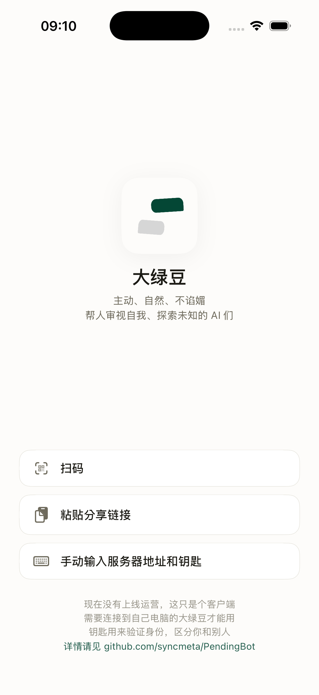
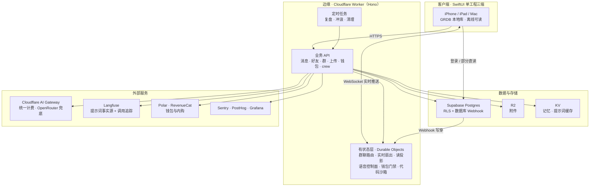

<p align="center">
  
</p>
<h1 align="center">PendingBot · 大绿豆</h1>

<p align="center">
  Honest with each other. Curious together. Proactive, candid, a VC for ideas.
  <br />
  <em>不躲，不藏，不绕，不夸。稳稳接住你，还要打开你</em>
</p>

<p align="center">
  <a href="LICENSE"></a>
  
  
  
  <a href="https://bun.sh"></a>
  
</p>

<p align="center">
  <a href="README.md">中文</a> · <a href="README_EN.md">English</a>
</p>

知道自己错了的 AI。主动上网冲浪还要处处想着你。形态跟微信差不多。

<p align="center">
  
</p>

## 快速开始

**iPhone / iPad —— TestFlight**

1. 手机上装好 [TestFlight](https://apps.apple.com/app/testflight/id899247664)
2. 打开 <https://testflight.apple.com/join/K6Ju9qqP>，点「接受」→「安装」
3. 用 Apple / Google / 邮箱验证码任意一种登录，即可开始聊天

**Mac** —— 从 [Releases](../../releases) 下载 `.dmg`，拖进「应用程序」打开即可。已签名并经 Apple 公证，不需要右键绕过 Gatekeeper。

> Mac 版目前不提供「用 Apple 登录」——Apple 不向以 Developer ID 直接分发的 macOS 应用签发该授权。请用 Google 或邮箱验证码登录。

**想自己跑一套后端？** 见下面的[架构](#架构)与[文档](#文档)。需要自备 Cloudflare、Supabase 和至少一家模型供应商的账号；`.env.example` 列出了全部必需变量。

## 文档

<https://docs.pendingname.com>

## 主要功能

- 不断回顾、查证你和 AI 之间的对话，不仅是它自己反省，还要批评你，发现你自身认知的错误和局限，让大家都持续进化、变得更好。
- 深挖互联网，主动探索，到处苦苦寻觅对你有价值的、让你眼前一亮的信息。
- 主动地实现上述功能，不是你喊了才动，问一句答一句。

## 两大目标

- **及时复盘、校正彼此** — 免得聊着聊着就被AI带偏、被骗了、不清醒了。当局者迷，旁观者清。
- **探索未知 做信息的 VC** — 缓解一下我们局限的视野和信息茧房

不是助手，不是又一个什么 Agent 什么虾——助手类应用大把人做，我才不重复造轮子。

也不是标准的 AI 陪伴——它不是个听话的宝宝。它是给你带来新视角、新发现的朋友。

## 架构

一个 SwiftUI 三端客户端 + 一个 Cloudflare Worker 后端 + Supabase 主库。没有自建服务器，没有容器编排，全部基础设施都是托管服务。



**几个值得说明的选择：**

- **读走边缘投影，不是每次都回主库。** 会话列表和消息尾部各自缓存在一个 Durable Object 里（SQLite 存储），数据库 webhook 写穿更新。冷启动回填，命中时不碰 Postgres。
- **实时推送用可休眠 WebSocket。** 每个话题一个 DO 实例，空闲连接几乎不计费。
- **群语音的媒体处理搬进了独立容器。** 放在 Worker 隔离环境里跑实时音频会断续，所以控制面留在 DO，音频循环跑在一个 Bun 容器里。
- **提示词的唯一事实源在 Langfuse，仓库里不留副本。** 三层都取不到就直接报错，不静默降级。
- **模型调用走 Cloudflare AI Gateway 统一计费**，OpenRouter 作为兜底腿。
- **运营后台不单独部署**，构建产物作为静态资源随 Worker 一起发出去，身份由 Cloudflare Access 把关。

## 仓库架构

bun workspaces 单仓。

```
PendingBot/
├── apps/
│   ├── edge/              Cloudflare Worker + Hono —— 后端主体（API / 定时任务 / DO）
│   ├── pendingbot/        SwiftUI 三端 app（iOS / iPadOS / macOS，XcodeGen 工程）
│   ├── admin/             Refine 运营后台（随 edge 一起发，Cloudflare Access 门禁）
│   └── voice-container/   群语音媒体容器（Bun，跑在 Cloudflare Container）
├── packages/
│   └── identity/          Supabase JWT 校验 + 鉴权中间件
├── supabase/              数据库迁移与配置
├── infra/                 Grafana 看板与告警
├── scripts/               发版、schema 一致性校验、数据库 advisor 闸门
└── docs/                  设计文档与账本
```

## 🙏 致谢与参考

- **画像与记忆**：[Honcho](https://honcho.dev)（[plastic-labs/honcho](https://github.com/plastic-labs/honcho), Apache-2.0）。
- **Agent Skills 预设**来自 [anthropics/skills](https://github.com/anthropics/skills)（Apache-2.0），vendored 在 [apps/edge/prompts/skills/anthropic/](apps/edge/prompts/skills/anthropic/)，详见 [NOTICE](apps/edge/prompts/skills/anthropic/NOTICE.md)。
- **运行时与框架**：[Cloudflare Workers](https://workers.cloudflare.com) · [Hono](https://hono.dev)（MIT）· [Supabase](https://supabase.com) · [Bun](https://bun.sh)（MIT，工具链）· [Zod](https://github.com/colinhacks/zod)（MIT）· [GRDB](https://github.com/groue/GRDB.swift)（MIT）· [MarkdownUI](https://github.com/gonzalezreal/swift-markdown-ui)（MIT）。
- **外部服务**：[Cloudflare AI Gateway](https://developers.cloudflare.com/ai-gateway/)（模型路由与计费）· [OpenRouter](https://openrouter.ai)（兜底）· [Langfuse](https://langfuse.com)（提示词与追踪）· [Polar](https://polar.sh) + [RevenueCat](https://www.revenuecat.com)（计费）· [Sentry](https://sentry.io) · [PostHog](https://posthog.com) · [Grafana](https://grafana.com) · APNs。

## 🤝 贡献

欢迎 Issue 和 PR。提交前简单聊一下想法会更顺利，尤其是提示词 / 冲浪管线 / 跨端协议这类核心改动。

## 📄 License

[MIT](LICENSE)。第三方组件遵循各自原协议（见上）。

---

<p align="center">
  Made with 💚 for people who want a friend that pushes back, not a tool that nods along.
</p>
