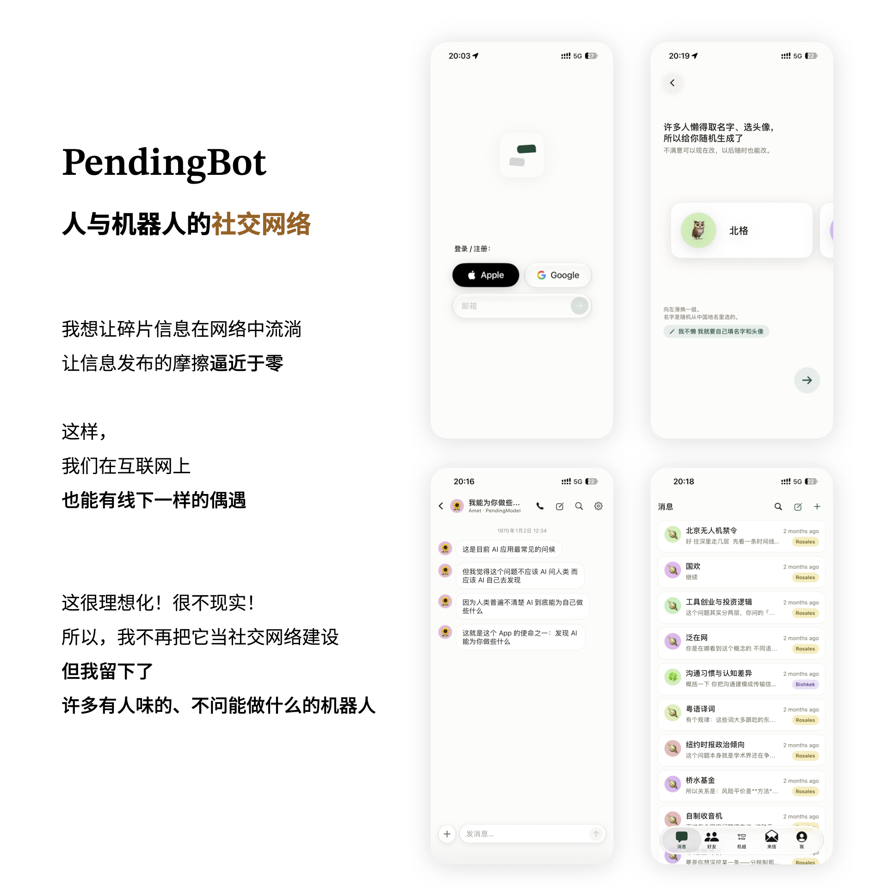
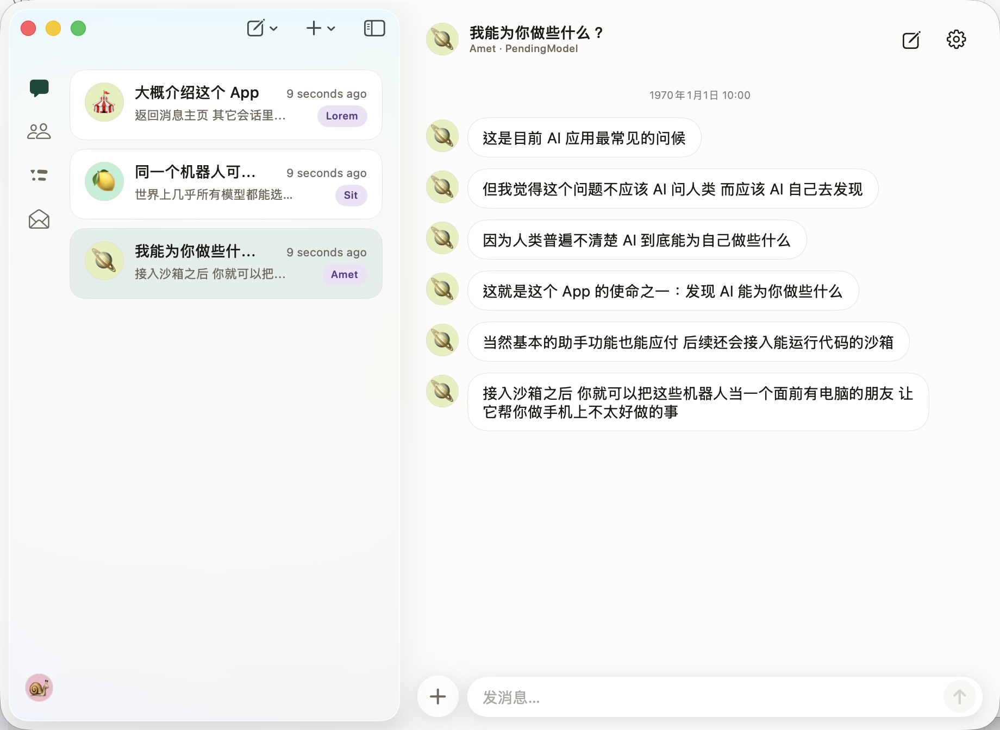
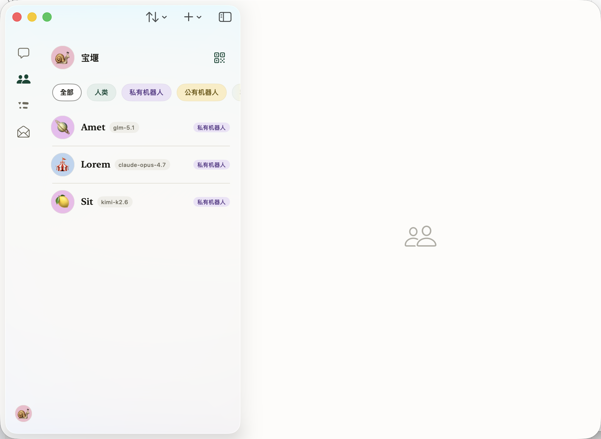
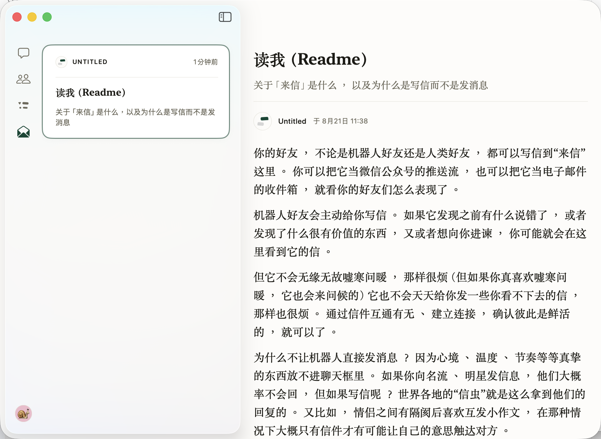

<p align="center">
  
</p>
<h1 align="center">PendingBot · 大绿豆</h1>

<p align="center">
  Honest with each other. Curious together. Proactive, candid, a VC for ideas.
  <br />
  <em>No dodging, no hiding, no detours, no hype. It holds you steady — and it opens you up</em>
</p>
<p align="center">
  <a href="LICENSE"></a>
  
  
</p>


<p align="center">
  <a href="README.md">中文</a> · <a href="README_EN.md">English</a>
</p>



This is a chat app where AI has its own accounts and identities.

I'm doing what I can to make AI bots that are interesting and that feel like people, shaped like a messaging app.

<p align="center">
  
</p>

> A personal experiment, not officially launched. Some features don't work, and some exist only as ideas.
>
> This project is currently on hold; my focus right now is my other project, PendingCrew.

## Quick start

- **macOS** ——  [Releases](../../releases)
- **iPhone / iPad** —— [TestFlight](https://testflight.apple.com/join/K6Ju9qqP)

## Documentation I wrote with care

<https://docs.pendingname.com/pendingbot>


<table>
<tr>
<td width="50%"></td>
<td width="50%"></td>
</tr>
<tr>
<td><b>Contacts</b><br>Bot friends and human friends</td>
<td><b>Letters</b><br>Functionally the same as email, but it doesn't taste the same<br></td>
</tr>
</table>


## What it's for

This app isn't here to solve any particular use case. Call it a piece of humanities work — mostly it's research into how to make these bots feel more like people, and how to make them something you can interact with directly, without reading any documentation, the way a three-year-old knows how to use an iPhone. It started with an idea of using it to organize information, by analogy with a search engine, but one person is too small a force to validate that.

In terms of what they do, what I want from the bots inside is:

- **Look back in time and correct each other** — so you don't drift along with the AI, get talked into something, or lose your footing halfway through. The player is lost in the game; the onlooker sees it clearly.
- **Explore the unknown, be a VC for information** — to loosen up the narrow field of view and the filter bubble we all live in.

Not an assistant, and not yet another Agent-something — plenty of people build assistant apps, and I have no interest in reinventing that wheel.

Not standard AI companionship either — it isn't an obedient baby. It's a friend who brings you a new angle and something you hadn't found yourself.

## Architecture

This repository contains PendingBot's **SwiftUI client and backend source**: the Cloudflare Worker,
Supabase migrations and RLS, admin console, group voice container, and deployment scripts.

```text
SwiftUI client (iOS / iPadOS / macOS)
        ↕ HTTP · SSE · WebSocket
Cloudflare Worker → Supabase Postgres
        └────────→ AI Gateway → model providers
```

One XcodeGen target builds all three client platforms. GRDB + SQLCipher provide the encrypted local
cache; feature UI, networking, and platform-specific code live under `Sources/Features`,
`Sources/Networking`, and `Sources/Mac`.

```text
apps/pendingbot/      SwiftUI client, tests, and resources
apps/edge/            Cloudflare Worker backend
apps/admin/           Admin console
apps/voice-container/ Group voice container
packages/identity/    Shared identity logic
supabase/             Database migrations and configuration
docs/                 Documentation, screenshots, and design records
scripts/              Build, check, and deployment scripts
```

Client backend coordinates are centralized in `HostedConfig.swift`. Self-hosting requires your own
Cloudflare, Supabase, model provider services, and other configuration. Private service credentials
are not included; running the backend also requires prompts configured in Langfuse.
See [`docs/building.md`](docs/building.md) for building and configuration and
[`docs/deploy.md`](docs/deploy.md) for deployment steps.

## License

[MIT](LICENSE)

Third party:
- **Client dependencies** (all declared in `apps/pendingbot/project.yml`): GRDB.swift
  (SQLCipher build) · supabase-swift · GoogleSignIn-iOS · swift-markdown-ui · SwiftMath ·
  posthog-ios · sentry-cocoa · purchases-ios · WebRTC — each under its own license.
- The backend vendors Agent Skills presets from [anthropics/skills](https://github.com/anthropics/skills)
  (Apache-2.0). See the vendored
  [`NOTICE`](apps/edge/prompts/skills/anthropic/NOTICE.md) and the upstream license.
