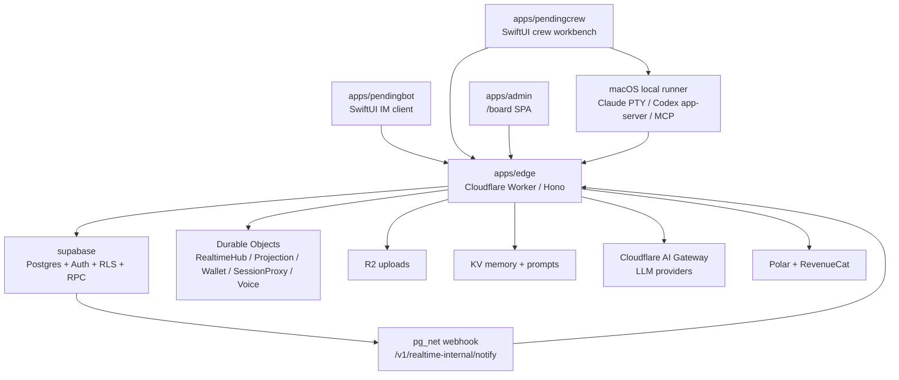

# Architecture and File Map

Generated by `node scripts/generate-architecture-map.mjs` at `2026-06-18T09:42:55.584Z`.

This document is a searchable map of the repository. The file-level roles are inferred from path conventions, known entry points, and leading comments, so treat it as a living index: correct important rows by improving path-specific rules in the generator.

## System Shape

## How To Read The Repo

- Start at `apps/edge/src/index.ts` for backend route mounting and runtime entry points.
- Start at `apps/pendingbot/Sources/PendingBotApp.swift` for the main IM app.
- Start at `apps/pendingcrew/Sources/PendingCrewApp.swift` and `apps/pendingcrew/Sources/Stores/AppModel.swift` for the crew app.
- Treat `supabase/migrations` as the data truth ledger: schema, RLS, RPC, triggers.
- Treat `docs/progress.md`, `docs/decisions.md`, and `docs/tech-debt.md` as the project state ledgers.

## Directory Responsibilities

| Directory | Responsibility |
|---|---|
| `apps/edge` | Backend hot path: REST/SSE/WS API, Cloudflare Durable Objects, queues, billing, LLM routing, realtime fan-out. |
| `apps/pendingbot` | PendingBot native client: chat, friends, voice, local cache, Supabase auth, edge API client. |
| `apps/pendingcrew` | PendingCrew native client: local-first crew workbench, device grant login, local agent runner, session proxy. |
| `apps/admin` | Internal board/admin SPA, backed by Edge APIs. |
| `apps/voice-container` | Containerized media engine used by group voice. |
| `packages/identity` | Shared Supabase JWT verification and Hono middleware. |
| `supabase` | Postgres migrations, RLS, RPC, DB webhooks, source-of-truth schema. |
| `infra` | Grafana dashboards and observability support files. |
| `scripts` | Repo automation, checks, generation utilities. |
| `docs` | Specs, implementation plans, decisions, progress, deploy notes, tech debt. |

## File Responsibilities

### apps/admin - 后台管理

| File | What it does |
|---|---|
| `apps/admin/index.html` | 项目文件：index。 |
| `apps/admin/package.json` | JSON 配置/数据：package。 |
| `apps/admin/README.md` | 文档：@pendingbot/admin — admin console。 |
| `apps/admin/src/App.tsx` | TypeScript 源码：App。 |
| `apps/admin/src/components/json-field.tsx` | Admin UI 组件：json field。 |
| `apps/admin/src/env.ts` | TypeScript 源码：env。 |
| `apps/admin/src/main.tsx` | Admin SPA React/Vite 入口。 |
| `apps/admin/src/pages/feature-flags.tsx` | Admin 页面：feature flags。 |
| `apps/admin/src/pages/mcp-servers.tsx` | Admin 页面：mcp servers。 |
| `apps/admin/src/pages/model-presets.tsx` | Admin 页面：model presets。 |
| `apps/admin/src/pages/model-roles.tsx` | Admin 页面：model roles。 |
| `apps/admin/src/pages/preset-bots.tsx` | Admin 页面：preset bots。 |
| `apps/admin/src/pages/preset-conversations.tsx` | Admin 页面：preset conversations。 |
| `apps/admin/src/pages/preset-groups.tsx` | Admin 页面：preset groups。 |
| `apps/admin/src/pages/preset-letters.tsx` | Admin 页面：preset letters。 |
| `apps/admin/src/pages/tools.tsx` | Admin 页面：tools。 |
| `apps/admin/src/providers/data-provider.ts` | Admin Refine data provider，只访问 Edge API。 |
| `apps/admin/src/providers/http.ts` | Admin 数据/路由 provider：http。 |
| `apps/admin/src/providers/resource-map.ts` | Admin resource 到 Edge route 的映射表。 |
| `apps/admin/tsconfig.json` | JSON 配置/数据：tsconfig。 |
| `apps/admin/vite.config.ts` | TypeScript 源码：vite.config。 |

### apps/edge - Cloudflare 后端

| File | What it does |
|---|---|
| `apps/edge/Dockerfile` | 项目文件：Dockerfile。 |
| `apps/edge/package.json` | JSON 配置/数据：package。 |
| `apps/edge/prompts/skills/anthropic/brand-guidelines.md` | 文档：Brand Styling。 |
| `apps/edge/prompts/skills/anthropic/doc-coauthoring.md` | 文档：Doc Co-Authoring Workflow。 |
| `apps/edge/prompts/skills/anthropic/internal-comms.md` | 文档：internal comms。 |
| `apps/edge/prompts/skills/anthropic/mcp-builder.md` | 文档：MCP Server Development Guide。 |
| `apps/edge/prompts/skills/anthropic/NOTICE.md` | 文档：Anthropic Skills — bundled presets。 |
| `apps/edge/prompts/skills/anthropic/skill-creator.md` | 文档：Skill Creator。 |
| `apps/edge/prompts/skills/anthropic/theme-factory.md` | 文档：Theme Factory Skill。 |
| `apps/edge/prompts/skills/pendingbot/code-runner.md` | 文档：Code Runner。 |
| `apps/edge/scripts/envelope-list-convs.ts` | TypeScript 源码：envelope list convs。 |
| `apps/edge/scripts/envelope-replay.ts` | TypeScript 源码：envelope replay。 |
| `apps/edge/scripts/fixtures/envelope-example.json` | JSON 配置/数据：envelope example。 |
| `apps/edge/scripts/polar-spike.ts` | TypeScript 源码：polar spike。 |
| `apps/edge/scripts/polar-verify.ts` | TypeScript 源码：polar verify。 |
| `apps/edge/scripts/push-secrets.sh` | Shell 脚本：push secrets。 |
| `apps/edge/scripts/seed-prompts.mjs` | 项目文件：seed prompts。 |
| `apps/edge/scripts/seed-public-skills.mjs` | 项目文件：seed public skills。 |
| `apps/edge/src/billing/group-wallet.test.ts` | Vitest 测试：覆盖 group wallet.。 |
| `apps/edge/src/billing/group-wallet.ts` | 计费层：group wallet。 |
| `apps/edge/src/billing/pnc.test.ts` | Vitest 测试：覆盖 pnc.。 |
| `apps/edge/src/billing/pnc.ts` | 计费层：pnc。 |
| `apps/edge/src/billing/polar-client.test.ts` | Vitest 测试：覆盖 polar client.。 |
| `apps/edge/src/billing/polar-client.ts` | 计费层：polar client。 |
| `apps/edge/src/billing/share-index.test.ts` | Vitest 测试：覆盖 share index.。 |
| `apps/edge/src/billing/share-index.ts` | 计费层：share index。 |
| `apps/edge/src/billing/usage-gate.test.ts` | Vitest 测试：覆盖 usage gate.。 |
| `apps/edge/src/billing/usage-gate.ts` | 计费层：usage gate。 |
| `apps/edge/src/billing/wallet-client.test.ts` | Vitest 测试：覆盖 wallet client.。 |
| `apps/edge/src/billing/wallet-client.ts` | 计费层：wallet client。 |
| `apps/edge/src/cron/account-deletion-sweep.ts` | Edge cron task：account deletion sweep。 |
| `apps/edge/src/cron/envelope-reaper.ts` | Edge cron task：envelope reaper。 |
| `apps/edge/src/cron/index.ts` | Edge cron task：index。 |
| `apps/edge/src/cron/preset-warm.ts` | Edge cron task：preset warm。 |
| `apps/edge/src/cron/uploads-cleanup.ts` | Edge cron task：uploads cleanup。 |
| `apps/edge/src/db/schema.ts` | 数据库类型/访问辅助：schema。 |
| `apps/edge/src/durable-objects/conv-projection.ts` | Cloudflare Durable Object：conv projection 状态/实时/控制逻辑。 |
| `apps/edge/src/durable-objects/group-router.ts` | Cloudflare Durable Object：group router 状态/实时/控制逻辑。 |
| `apps/edge/src/durable-objects/hub.ts` | Cloudflare Durable Object：hub 状态/实时/控制逻辑。 |
| `apps/edge/src/durable-objects/realtime-meter.ts` | Cloudflare Durable Object：realtime meter 状态/实时/控制逻辑。 |
| `apps/edge/src/durable-objects/room-media-protocol.ts` | Cloudflare Durable Object：room media protocol 状态/实时/控制逻辑。 |
| `apps/edge/src/durable-objects/room-media.ts` | Cloudflare Durable Object：room media 状态/实时/控制逻辑。 |
| `apps/edge/src/durable-objects/room-voice-context.test.ts` | Vitest 测试：覆盖 room voice context.。 |
| `apps/edge/src/durable-objects/room-voice-context.ts` | Cloudflare Durable Object：room voice context 状态/实时/控制逻辑。 |
| `apps/edge/src/durable-objects/room-voice-policy.test.ts` | Vitest 测试：覆盖 room voice policy.。 |
| `apps/edge/src/durable-objects/room-voice-policy.ts` | Cloudflare Durable Object：room voice policy 状态/实时/控制逻辑。 |
| `apps/edge/src/durable-objects/room-voice-reconnect.test.ts` | Vitest 测试：覆盖 room voice reconnect.。 |
| `apps/edge/src/durable-objects/room-voice-reconnect.ts` | Cloudflare Durable Object：room voice reconnect 状态/实时/控制逻辑。 |
| `apps/edge/src/durable-objects/room-voice.ts` | Cloudflare Durable Object：room voice 状态/实时/控制逻辑。 |
| `apps/edge/src/durable-objects/session-proxy.ts` | Cloudflare Durable Object：session proxy 状态/实时/控制逻辑。 |
| `apps/edge/src/durable-objects/user-projection.ts` | Cloudflare Durable Object：user projection 状态/实时/控制逻辑。 |
| `apps/edge/src/durable-objects/wallet.test.ts` | Vitest 测试：覆盖 wallet.。 |
| `apps/edge/src/durable-objects/wallet.ts` | Cloudflare Durable Object：wallet 状态/实时/控制逻辑。 |
| `apps/edge/src/i18n/index.ts` | TypeScript 源码：index。 |
| `apps/edge/src/i18n/locale.ts` | TypeScript 源码：locale。 |
| `apps/edge/src/i18n/locales/en.ts` | TypeScript 源码：en。 |
| `apps/edge/src/i18n/locales/zh.ts` | TypeScript 源码：zh。 |
| `apps/edge/src/i18n/prompts.ts` | TypeScript 源码：prompts。 |
| `apps/edge/src/i18n/types.ts` | TypeScript 源码：types。 |
| `apps/edge/src/index.ts` | Cloudflare Worker 总入口：Hono 路由、DO 导出、cron、queue、Sentry。 |
| `apps/edge/src/lib/ai-gateway.ts` | Edge 业务库：ai gateway。 |
| `apps/edge/src/lib/analytics.test.ts` | Vitest 测试：覆盖 analytics.。 |
| `apps/edge/src/lib/analytics.ts` | Edge 业务库：analytics。 |
| `apps/edge/src/lib/apns.ts` | Edge 业务库：apns。 |
| `apps/edge/src/lib/attachment-cache.ts` | Edge 业务库：attachment cache。 |
| `apps/edge/src/lib/attachments-persist.ts` | Edge 业务库：attachments persist。 |
| `apps/edge/src/lib/attachments.test.ts` | Vitest 测试：覆盖 attachments.。 |
| `apps/edge/src/lib/attachments.ts` | Edge 业务库：attachments。 |
| `apps/edge/src/lib/billing-grant.test.ts` | Vitest 测试：覆盖 billing grant.。 |
| `apps/edge/src/lib/billing-grant.ts` | Edge 业务库：billing grant。 |
| `apps/edge/src/lib/billing-packs.test.ts` | Vitest 测试：覆盖 billing packs.。 |
| `apps/edge/src/lib/billing-packs.ts` | Edge 业务库：billing packs。 |
| `apps/edge/src/lib/billing-polar.test.ts` | Vitest 测试：覆盖 billing polar.。 |
| `apps/edge/src/lib/billing-polar.ts` | Edge 业务库：billing polar。 |
| `apps/edge/src/lib/billing.test.ts` | Vitest 测试：覆盖 billing.。 |
| `apps/edge/src/lib/billing.ts` | Edge 业务库：billing。 |
| `apps/edge/src/lib/board-audit.ts` | Edge 业务库：board audit。 |
| `apps/edge/src/lib/board-resource.ts` | Edge 业务库：board resource。 |
| `apps/edge/src/lib/bot-cache.ts` | Edge 业务库：bot cache。 |
| `apps/edge/src/lib/bot-reply/index.ts` | Edge 业务库：index。 |
| `apps/edge/src/lib/bot-reply/mcp-dispatch.ts` | Edge 业务库：mcp dispatch。 |
| `apps/edge/src/lib/bot-reply/tool-defs.test.ts` | Vitest 测试：覆盖 tool defs.。 |
| `apps/edge/src/lib/bot-reply/tool-defs.ts` | Edge 业务库：tool defs。 |
| `apps/edge/src/lib/bot-reply/tool-runner.ts` | Edge 业务库：tool runner。 |
| `apps/edge/src/lib/bot-reply/tools/ask-friend.ts` | Bot 工具实现：ask friend。 |
| `apps/edge/src/lib/bot-reply/tools/code-exec.ts` | Bot 工具实现：code exec。 |
| `apps/edge/src/lib/bot-reply/tools/create-skill.ts` | Bot 工具实现：create skill。 |
| `apps/edge/src/lib/bot-reply/tools/delegate.ts` | Bot 工具实现：delegate。 |
| `apps/edge/src/lib/bot-reply/tools/group-meta.ts` | Bot 工具实现：group meta。 |
| `apps/edge/src/lib/bot-reply/tools/prompt-model-guess.ts` | Bot 工具实现：prompt model guess。 |
| `apps/edge/src/lib/bot-reply/tools/read-attachment.ts` | Bot 工具实现：read attachment。 |
| `apps/edge/src/lib/bot-reply/tools/search-history.ts` | Bot 工具实现：search history。 |
| `apps/edge/src/lib/bot-reply/tools/send-images.test.ts` | Vitest 测试：覆盖 send images.。 |
| `apps/edge/src/lib/bot-reply/tools/send-images.ts` | Bot 工具实现：send images。 |
| `apps/edge/src/lib/bot-reply/tools/submit-inquiry-answer.ts` | Bot 工具实现：submit inquiry answer。 |
| `apps/edge/src/lib/bot-social.ts` | Edge 业务库：bot social。 |
| `apps/edge/src/lib/cf-access.test.ts` | Vitest 测试：覆盖 cf access.。 |
| `apps/edge/src/lib/cf-access.ts` | Edge 业务库：cf access。 |
| `apps/edge/src/lib/cf-turn.ts` | Edge 业务库：cf turn。 |
| `apps/edge/src/lib/conv-cache.ts` | Edge 业务库：conv cache。 |
| `apps/edge/src/lib/conversation-model.test.ts` | Vitest 测试：覆盖 conversation model.。 |
| `apps/edge/src/lib/conversation-model.ts` | Edge 业务库：conversation model。 |
| `apps/edge/src/lib/crew-outbound.ts` | Edge 业务库：crew outbound。 |
| `apps/edge/src/lib/device-grant-scopes.ts` | Edge 业务库：device grant scopes。 |
| `apps/edge/src/lib/device-grants.ts` | Edge 业务库：device grants。 |
| `apps/edge/src/lib/envelope-loop.ts` | Edge 业务库：envelope loop。 |
| `apps/edge/src/lib/envelope-runner.ts` | Edge 业务库：envelope runner。 |
| `apps/edge/src/lib/feature-flags.test.ts` | Vitest 测试：覆盖 feature flags.。 |
| `apps/edge/src/lib/feature-flags.ts` | Edge 业务库：feature flags。 |
| `apps/edge/src/lib/group-bot-intro.ts` | Edge 业务库：group bot intro。 |
| `apps/edge/src/lib/group-dispatch.ts` | Edge 业务库：group dispatch。 |
| `apps/edge/src/lib/group-mentions.ts` | Edge 业务库：group mentions。 |
| `apps/edge/src/lib/honcho.ts` | Edge 业务库：honcho。 |
| `apps/edge/src/lib/http-error.test.ts` | Vitest 测试：覆盖 http error.。 |
| `apps/edge/src/lib/http-error.ts` | Edge 业务库：http error。 |
| `apps/edge/src/lib/ids.ts` | Edge 业务库：ids。 |
| `apps/edge/src/lib/kv-config.ts` | Edge 业务库：kv config。 |
| `apps/edge/src/lib/langfuse-client.ts` | Edge 业务库：langfuse client。 |
| `apps/edge/src/lib/llm-trace.test.ts` | Vitest 测试：覆盖 llm trace.。 |
| `apps/edge/src/lib/llm-trace.ts` | Edge 业务库：llm trace。 |
| `apps/edge/src/lib/lookback-runner.ts` | Edge 业务库：lookback runner。 |
| `apps/edge/src/lib/memory.ts` | Edge 业务库：memory。 |
| `apps/edge/src/lib/model-presets.test.ts` | Vitest 测试：覆盖 model presets.。 |
| `apps/edge/src/lib/model-presets.ts` | Edge 业务库：model presets。 |
| `apps/edge/src/lib/model-roles.ts` | Edge 业务库：model roles。 |
| `apps/edge/src/lib/openai-regions.ts` | Edge 业务库：openai regions。 |
| `apps/edge/src/lib/persona-cache.ts` | Edge 业务库：persona cache。 |
| `apps/edge/src/lib/projection-writethrough.ts` | Edge 业务库：projection writethrough。 |
| `apps/edge/src/lib/push.test.ts` | Vitest 测试：覆盖 push.。 |
| `apps/edge/src/lib/push.ts` | Edge 业务库：push。 |
| `apps/edge/src/lib/rate-limit.test.ts` | Vitest 测试：覆盖 rate limit.。 |
| `apps/edge/src/lib/rate-limit.ts` | Edge 业务库：rate limit。 |
| `apps/edge/src/lib/realtime-publish.ts` | Edge 业务库：realtime publish。 |
| `apps/edge/src/lib/realtime-sessions.test.ts` | Vitest 测试：覆盖 realtime sessions.。 |
| `apps/edge/src/lib/realtime-sessions.ts` | Edge 业务库：realtime sessions。 |
| `apps/edge/src/lib/realtimekit-lifecycle.test.ts` | Vitest 测试：覆盖 realtimekit lifecycle.。 |
| `apps/edge/src/lib/realtimekit-lifecycle.ts` | Edge 业务库：realtimekit lifecycle。 |
| `apps/edge/src/lib/realtimekit.test.ts` | Vitest 测试：覆盖 realtimekit.。 |
| `apps/edge/src/lib/realtimekit.ts` | Edge 业务库：realtimekit。 |
| `apps/edge/src/lib/route-authz.ts` | Edge 业务库：route authz。 |
| `apps/edge/src/lib/safe-wait-until.ts` | Edge 业务库：safe wait until。 |
| `apps/edge/src/lib/sandbox.test.ts` | Vitest 测试：覆盖 sandbox.。 |
| `apps/edge/src/lib/sandbox.ts` | Edge 业务库：sandbox。 |
| `apps/edge/src/lib/session-proxy-protocol.ts` | Edge 业务库：session proxy protocol。 |
| `apps/edge/src/lib/sse-keepalive.ts` | Edge 业务库：sse keepalive。 |
| `apps/edge/src/lib/supabase.ts` | Edge 业务库：supabase。 |
| `apps/edge/src/lib/title-runner.ts` | Edge 业务库：title runner。 |
| `apps/edge/src/lib/tools-registry.ts` | Edge 业务库：tools registry。 |
| `apps/edge/src/lib/track.test.ts` | Vitest 测试：覆盖 track.。 |
| `apps/edge/src/lib/track.ts` | Edge 业务库：track。 |
| `apps/edge/src/lib/unread-state.ts` | Edge 业务库：unread state。 |
| `apps/edge/src/lib/voice-config.ts` | Edge 业务库：voice config。 |
| `apps/edge/src/lib/voice-metering.test.ts` | Vitest 测试：覆盖 voice metering.。 |
| `apps/edge/src/lib/voice-metering.ts` | Edge 业务库：voice metering。 |
| `apps/edge/src/lib/web-meter.ts` | Edge 业务库：web meter。 |
| `apps/edge/src/lib/web-types.ts` | Edge 业务库：web types。 |
| `apps/edge/src/llm/anthropic-adapter.test.ts` | Vitest 测试：覆盖 anthropic adapter.。 |
| `apps/edge/src/llm/anthropic-adapter.ts` | LLM 层：anthropic adapter。 |
| `apps/edge/src/llm/builder.test.ts` | Vitest 测试：覆盖 builder.。 |
| `apps/edge/src/llm/builder.ts` | LLM 层：builder。 |
| `apps/edge/src/llm/catalog.ts` | LLM 层：catalog。 |
| `apps/edge/src/llm/gemini-adapter.test.ts` | Vitest 测试：覆盖 gemini adapter.。 |
| `apps/edge/src/llm/gemini-adapter.ts` | LLM 层：gemini adapter。 |
| `apps/edge/src/llm/group-router.ts` | LLM 层：group router。 |
| `apps/edge/src/llm/prompt-loader.test.ts` | Vitest 测试：覆盖 prompt loader.。 |
| `apps/edge/src/llm/prompt-loader.ts` | LLM 层：prompt loader。 |
| `apps/edge/src/llm/prompt-names.ts` | LLM 层：prompt names。 |
| `apps/edge/src/llm/prompts.d.ts` | LLM 层：prompts.d。 |
| `apps/edge/src/llm/provider-usage.test.ts` | Vitest 测试：覆盖 provider usage.。 |
| `apps/edge/src/llm/provider-usage.ts` | LLM 层：provider usage。 |
| `apps/edge/src/llm/providers.ts` | LLM 层：providers。 |
| `apps/edge/src/llm/random-model.test.ts` | Vitest 测试：覆盖 random model.。 |
| `apps/edge/src/llm/random-model.ts` | LLM 层：random model。 |
| `apps/edge/src/llm/responses-adapter.test.ts` | Vitest 测试：覆盖 responses adapter.。 |
| `apps/edge/src/llm/responses-adapter.ts` | LLM 层：responses adapter。 |
| `apps/edge/src/llm/router-billing.test.ts` | Vitest 测试：覆盖 router billing.。 |
| `apps/edge/src/llm/router-trace.test.ts` | Vitest 测试：覆盖 router trace.。 |
| `apps/edge/src/llm/router.test.ts` | Vitest 测试：覆盖 router.。 |
| `apps/edge/src/llm/router.ts` | LLM 层：router。 |
| `apps/edge/src/llm/session-world-model.test.ts` | Vitest 测试：覆盖 session world model.。 |
| `apps/edge/src/llm/session-world-model.ts` | LLM 层：session world model。 |
| `apps/edge/src/llm/token-estimate.ts` | LLM 层：token estimate。 |
| `apps/edge/src/llm/vision.ts` | LLM 层：vision。 |
| `apps/edge/src/mcp/client.ts` | MCP 集成：client。 |
| `apps/edge/src/mcp/parsers.ts` | MCP 集成：parsers。 |
| `apps/edge/src/queue/audit-types.ts` | TypeScript 源码：audit types。 |
| `apps/edge/src/routes/billing-webhooks.ts` | Edge route：billing webhooks 相关 HTTP/SSE/WS API。 |
| `apps/edge/src/routes/board-feature-flags.ts` | Edge route：board feature flags 相关 HTTP/SSE/WS API。 |
| `apps/edge/src/routes/board-model-roles.ts` | Edge route：board model roles 相关 HTTP/SSE/WS API。 |
| `apps/edge/src/routes/board.ts` | Edge route：board 相关 HTTP/SSE/WS API。 |
| `apps/edge/src/routes/bot-invites.ts` | Edge route：bot invites 相关 HTTP/SSE/WS API。 |
| `apps/edge/src/routes/bots.ts` | Edge route：bots 相关 HTTP/SSE/WS API。 |
| `apps/edge/src/routes/code-exec.ts` | Edge route：code exec 相关 HTTP/SSE/WS API。 |
| `apps/edge/src/routes/contacts.ts` | Edge route：contacts 相关 HTTP/SSE/WS API。 |
| `apps/edge/src/routes/conversation-model-routes.ts` | Edge route：conversation model routes 相关 HTTP/SSE/WS API。 |
| `apps/edge/src/routes/crew-comms.ts` | Edge route：crew comms 相关 HTTP/SSE/WS API。 |
| `apps/edge/src/routes/crew-interactions.ts` | Edge route：crew interactions 相关 HTTP/SSE/WS API。 |
| `apps/edge/src/routes/crew.ts` | Edge route：crew 相关 HTTP/SSE/WS API。 |
| `apps/edge/src/routes/crews.ts` | Edge route：crews 相关 HTTP/SSE/WS API。 |
| `apps/edge/src/routes/device-grant.ts` | Edge route：device grant 相关 HTTP/SSE/WS API。 |
| `apps/edge/src/routes/device-login.ts` | Edge route：device login 相关 HTTP/SSE/WS API。 |
| `apps/edge/src/routes/devices.ts` | Edge route：devices 相关 HTTP/SSE/WS API。 |
| `apps/edge/src/routes/envelope.ts` | Edge route：envelope 相关 HTTP/SSE/WS API。 |
| `apps/edge/src/routes/friend-requests.ts` | Edge route：friend requests 相关 HTTP/SSE/WS API。 |
| `apps/edge/src/routes/group-invites.ts` | Edge route：group invites 相关 HTTP/SSE/WS API。 |
| `apps/edge/src/routes/group-subjects.ts` | Edge route：group subjects 相关 HTTP/SSE/WS API。 |
| `apps/edge/src/routes/group-voice.ts` | Edge route：group voice 相关 HTTP/SSE/WS API。 |
| `apps/edge/src/routes/groups.ts` | Edge route：groups 相关 HTTP/SSE/WS API。 |
| `apps/edge/src/routes/health.ts` | Edge route：health 相关 HTTP/SSE/WS API。 |
| `apps/edge/src/routes/human-help-requests.ts` | Edge route：human help requests 相关 HTTP/SSE/WS API。 |
| `apps/edge/src/routes/langfuse-prompts.test.ts` | Vitest 测试：覆盖 langfuse prompts.。 |
| `apps/edge/src/routes/langfuse-prompts.ts` | Edge route：langfuse prompts 相关 HTTP/SSE/WS API。 |
| `apps/edge/src/routes/machines.ts` | Edge route：machines 相关 HTTP/SSE/WS API。 |
| `apps/edge/src/routes/me.ts` | Edge route：me 相关 HTTP/SSE/WS API。 |
| `apps/edge/src/routes/messages.ts` | Edge route：messages 相关 HTTP/SSE/WS API。 |
| `apps/edge/src/routes/model-presets.ts` | Edge route：model presets 相关 HTTP/SSE/WS API。 |
| `apps/edge/src/routes/models.test.ts` | Vitest 测试：覆盖 models.。 |
| `apps/edge/src/routes/models.ts` | Edge route：models 相关 HTTP/SSE/WS API。 |
| `apps/edge/src/routes/permission-requests.ts` | Edge route：permission requests 相关 HTTP/SSE/WS API。 |
| `apps/edge/src/routes/projections.ts` | Edge route：projections 相关 HTTP/SSE/WS API。 |
| `apps/edge/src/routes/realtime-hub.ts` | Edge route：realtime hub 相关 HTTP/SSE/WS API。 |
| `apps/edge/src/routes/realtime-internal.ts` | Edge route：realtime internal 相关 HTTP/SSE/WS API。 |
| `apps/edge/src/routes/realtime.ts` | Edge route：realtime 相关 HTTP/SSE/WS API。 |
| `apps/edge/src/routes/runner-hosts.ts` | Edge route：runner hosts 相关 HTTP/SSE/WS API。 |
| `apps/edge/src/routes/session-proxy.ts` | Edge route：session proxy 相关 HTTP/SSE/WS API。 |
| `apps/edge/src/routes/share-changes.ts` | Edge route：share changes 相关 HTTP/SSE/WS API。 |
| `apps/edge/src/routes/upload.ts` | Edge route：upload 相关 HTTP/SSE/WS API。 |
| `apps/edge/src/routes/voice-active.ts` | Edge route：voice active 相关 HTTP/SSE/WS API。 |
| `apps/edge/src/routes/well-known.ts` | Edge route：well known 相关 HTTP/SSE/WS API。 |
| `apps/edge/src/types.ts` | Worker Env / Hono vars 类型定义，对齐 wrangler 绑定。 |
| `apps/edge/tests/_helpers/do-sqlite.ts` | Edge 集成测试/helper：do sqlite。 |
| `apps/edge/tests/_helpers/fake-supabase.ts` | Edge 集成测试/helper：fake supabase。 |
| `apps/edge/tests/board-feature-flags.test.ts` | Vitest 测试：覆盖 board feature flags.。 |
| `apps/edge/tests/board-preset-bots.test.ts` | Vitest 测试：覆盖 board preset bots.。 |
| `apps/edge/tests/board-preset-templates.test.ts` | Vitest 测试：覆盖 board preset templates.。 |
| `apps/edge/tests/crew-comms.test.ts` | Vitest 测试：覆盖 crew comms.。 |
| `apps/edge/tests/crew.test.ts` | Vitest 测试：覆盖 crew.。 |
| `apps/edge/tests/crews.test.ts` | Vitest 测试：覆盖 crews.。 |
| `apps/edge/tests/device-grant-mint.test.ts` | Vitest 测试：覆盖 device grant mint.。 |
| `apps/edge/tests/device-login.test.ts` | Vitest 测试：覆盖 device login.。 |
| `apps/edge/tests/friend-requests.test.ts` | Vitest 测试：覆盖 friend requests.。 |
| `apps/edge/tests/human-help-requests.test.ts` | Vitest 测试：覆盖 human help requests.。 |
| `apps/edge/tests/identity-jwt.test.ts` | Vitest 测试：覆盖 identity jwt.。 |
| `apps/edge/tests/machines.test.ts` | Vitest 测试：覆盖 machines.。 |
| `apps/edge/tests/me-family-credential.test.ts` | Vitest 测试：覆盖 me family credential.。 |
| `apps/edge/tests/me-subject.test.ts` | Vitest 测试：覆盖 me subject.。 |
| `apps/edge/tests/messages-attachments.test.ts` | Vitest 测试：覆盖 messages attachments.。 |
| `apps/edge/tests/messages-recall.test.ts` | Vitest 测试：覆盖 messages recall.。 |
| `apps/edge/tests/migrations-security.test.ts` | Vitest 测试：覆盖 migrations security.。 |
| `apps/edge/tests/permission-requests.test.ts` | Vitest 测试：覆盖 permission requests.。 |
| `apps/edge/tests/privacy-logging.test.ts` | Vitest 测试：覆盖 privacy logging.。 |
| `apps/edge/tests/projection-do.test.ts` | Vitest 测试：覆盖 projection do.。 |
| `apps/edge/tests/push-mute.test.ts` | Vitest 测试：覆盖 push mute.。 |
| `apps/edge/tests/realtime-hub.test.ts` | Vitest 测试：覆盖 realtime hub.。 |
| `apps/edge/tests/route-authz.test.ts` | Vitest 测试：覆盖 route authz.。 |
| `apps/edge/tests/runner-hosts.test.ts` | Vitest 测试：覆盖 runner hosts.。 |
| `apps/edge/tests/session-proxy.test.ts` | Vitest 测试：覆盖 session proxy.。 |
| `apps/edge/tests/upload.test.ts` | Vitest 测试：覆盖 upload.。 |
| `apps/edge/tsconfig.json` | JSON 配置/数据：tsconfig。 |
| `apps/edge/wrangler.jsonc` | Cloudflare 部署与资源绑定：routes、DO、R2、KV、Queue、Container、secrets 说明。 |

### apps/pendingbot - PendingBot 客户端

| File | What it does |
|---|---|
| `apps/pendingbot/ExportOptions.plist` | Apple plist 配置：Export Options。 |
| `apps/pendingbot/Info.plist` | Apple plist 配置：Info。 |
| `apps/pendingbot/PendingBot.xcodeproj/project.pbxproj` | Xcode project 生成/工程元数据：project。 |
| `apps/pendingbot/PendingBot.xcodeproj/project.xcworkspace/contents.xcworkspacedata` | Xcode project 生成/工程元数据：contents。 |
| `apps/pendingbot/project.yml` | 项目文件：project。 |
| `apps/pendingbot/README.md` | 文档：PendingBot。 |
| `apps/pendingbot/Resources/Assets.xcassets/AccentColor.colorset/Contents.json` | App 资源/asset catalog：Contents。 |
| `apps/pendingbot/Resources/Assets.xcassets/AppIcon.appiconset/Contents.json` | App 资源/asset catalog：Contents。 |
| `apps/pendingbot/Resources/Assets.xcassets/AppIcon.appiconset/icon-1024.png` | App 资源/asset catalog：icon 1024。 |
| `apps/pendingbot/Resources/Assets.xcassets/AppIcon.appiconset/mac-128.png` | App 资源/asset catalog：mac 128。 |
| `apps/pendingbot/Resources/Assets.xcassets/AppIcon.appiconset/mac-128@2x.png` | App 资源/asset catalog：mac 128@2x。 |
| `apps/pendingbot/Resources/Assets.xcassets/AppIcon.appiconset/mac-16.png` | App 资源/asset catalog：mac 16。 |
| `apps/pendingbot/Resources/Assets.xcassets/AppIcon.appiconset/mac-16@2x.png` | App 资源/asset catalog：mac 16@2x。 |
| `apps/pendingbot/Resources/Assets.xcassets/AppIcon.appiconset/mac-256.png` | App 资源/asset catalog：mac 256。 |
| `apps/pendingbot/Resources/Assets.xcassets/AppIcon.appiconset/mac-256@2x.png` | App 资源/asset catalog：mac 256@2x。 |
| `apps/pendingbot/Resources/Assets.xcassets/AppIcon.appiconset/mac-32.png` | App 资源/asset catalog：mac 32。 |
| `apps/pendingbot/Resources/Assets.xcassets/AppIcon.appiconset/mac-32@2x.png` | App 资源/asset catalog：mac 32@2x。 |
| `apps/pendingbot/Resources/Assets.xcassets/AppIcon.appiconset/mac-512.png` | App 资源/asset catalog：mac 512。 |
| `apps/pendingbot/Resources/Assets.xcassets/AppIcon.appiconset/mac-512@2x.png` | App 资源/asset catalog：mac 512@2x。 |
| `apps/pendingbot/Resources/Assets.xcassets/AppleSignInLogo.imageset/Contents.json` | App 资源/asset catalog：Contents。 |
| `apps/pendingbot/Resources/Assets.xcassets/AppleSignInLogo.imageset/README.md` | 文档：AppleSignInLogo asset。 |
| `apps/pendingbot/Resources/Assets.xcassets/BrandMark.imageset/brand-mark.svg` | App 资源/asset catalog：brand mark。 |
| `apps/pendingbot/Resources/Assets.xcassets/BrandMark.imageset/Contents.json` | App 资源/asset catalog：Contents。 |
| `apps/pendingbot/Resources/Assets.xcassets/Contents.json` | App 资源/asset catalog：Contents。 |
| `apps/pendingbot/Resources/Assets.xcassets/Cream.colorset/Contents.json` | App 资源/asset catalog：Contents。 |
| `apps/pendingbot/Resources/Assets.xcassets/GoogleG.imageset/Contents.json` | App 资源/asset catalog：Contents。 |
| `apps/pendingbot/Resources/Assets.xcassets/GoogleG.imageset/g-logo.png` | App 资源/asset catalog：g logo。 |
| `apps/pendingbot/Resources/Assets.xcassets/LaunchLogo.imageset/Contents.json` | App 资源/asset catalog：Contents。 |
| `apps/pendingbot/Resources/Assets.xcassets/LaunchLogo.imageset/launch-logo.png` | App 资源/asset catalog：launch logo。 |
| `apps/pendingbot/Resources/Info.plist` | Apple plist 配置：Info。 |
| `apps/pendingbot/Resources/Localizable.xcstrings` | 项目文件：Localizable。 |
| `apps/pendingbot/Resources/names.txt` | 项目文件：names。 |
| `apps/pendingbot/Resources/PendingBot.entitlements` | Apple entitlement 配置：Pending Bot。 |
| `apps/pendingbot/Resources/place_names.txt` | 项目文件：place names。 |
| `apps/pendingbot/Resources/PrivacyInfo.xcprivacy` | 项目文件：Privacy Info。 |
| `apps/pendingbot/scripts/fetch-brand-assets.sh` | Shell 脚本：fetch brand assets。 |
| `apps/pendingbot/Sources/Components/BlinkingCursor.swift` | PendingBot 共享 UI 组件：Blinking Cursor。 |
| `apps/pendingbot/Sources/Components/BotAvatar.swift` | PendingBot 共享 UI 组件：Bot Avatar。 |
| `apps/pendingbot/Sources/Components/BotVisibilityTag.swift` | PendingBot 共享 UI 组件：Bot Visibility Tag。 |
| `apps/pendingbot/Sources/Components/BrandAvatar.swift` | PendingBot 共享 UI 组件：Brand Avatar。 |
| `apps/pendingbot/Sources/Components/Clipboard.swift` | PendingBot 共享 UI 组件：Clipboard。 |
| `apps/pendingbot/Sources/Components/CodeRunnerSheet.swift` | PendingBot 共享 UI 组件：Code Runner Sheet。 |
| `apps/pendingbot/Sources/Components/ColorHash.swift` | PendingBot 共享 UI 组件：Color Hash。 |
| `apps/pendingbot/Sources/Components/ColorHex.swift` | PendingBot 共享 UI 组件：Color Hex。 |
| `apps/pendingbot/Sources/Components/DeepLinkStore.swift` | PendingBot 共享 UI 组件：Deep Link Store。 |
| `apps/pendingbot/Sources/Components/EmptyHint.swift` | PendingBot 共享 UI 组件：Empty Hint。 |
| `apps/pendingbot/Sources/Components/GroupAvatar.swift` | PendingBot 共享 UI 组件：Group Avatar。 |
| `apps/pendingbot/Sources/Components/Haptics.swift` | PendingBot 共享 UI 组件：Haptics。 |
| `apps/pendingbot/Sources/Components/LetterSenderAvatar.swift` | PendingBot 共享 UI 组件：Letter Sender Avatar。 |
| `apps/pendingbot/Sources/Components/MarkdownText.swift` | PendingBot 共享 UI 组件：Markdown Text。 |
| `apps/pendingbot/Sources/Components/MathRendering.swift` | PendingBot 共享 UI 组件：Math Rendering。 |
| `apps/pendingbot/Sources/Components/ModelPicker.swift` | PendingBot 共享 UI 组件：Model Picker。 |
| `apps/pendingbot/Sources/Components/MyQRBusinessCard.swift` | PendingBot 共享 UI 组件：My QRBusiness Card。 |
| `apps/pendingbot/Sources/Components/Platform.swift` | PendingBot 共享 UI 组件：Platform。 |
| `apps/pendingbot/Sources/Components/PlatformImage.swift` | PendingBot 共享 UI 组件：Platform Image。 |
| `apps/pendingbot/Sources/Components/PlatformModifiers.swift` | PendingBot 共享 UI 组件：Platform Modifiers。 |
| `apps/pendingbot/Sources/Components/QRCode.swift` | PendingBot 共享 UI 组件：QRCode。 |
| `apps/pendingbot/Sources/Components/QRScannerView.swift` | PendingBot 共享 UI 组件：QRScanner View。 |
| `apps/pendingbot/Sources/Components/RelativeMessageTime.swift` | PendingBot 共享 UI 组件：Relative Message Time。 |
| `apps/pendingbot/Sources/Components/ServerImage.swift` | PendingBot 共享 UI 组件：Server Image。 |
| `apps/pendingbot/Sources/Components/SidebarTabBar.swift` | PendingBot 共享 UI 组件：Sidebar Tab Bar。 |
| `apps/pendingbot/Sources/Components/SplitNav.swift` | PendingBot 共享 UI 组件：Split Nav。 |
| `apps/pendingbot/Sources/Components/SwipeRevealRow.swift` | PendingBot 共享 UI 组件：Swipe Reveal Row。 |
| `apps/pendingbot/Sources/Components/TabHeaderBar.swift` | PendingBot 共享 UI 组件：Tab Header Bar。 |
| `apps/pendingbot/Sources/Components/TabTitle.swift` | PendingBot 共享 UI 组件：Tab Title。 |
| `apps/pendingbot/Sources/Components/Theme.swift` | PendingBot 共享 UI 组件：Theme。 |
| `apps/pendingbot/Sources/Components/TypingDots.swift` | PendingBot 共享 UI 组件：Typing Dots。 |
| `apps/pendingbot/Sources/Components/UserAvatar.swift` | PendingBot 共享 UI 组件：User Avatar。 |
| `apps/pendingbot/Sources/Features/Call/ActiveCallBanner.swift` | PendingBot 功能界面/逻辑：Active Call Banner。 |
| `apps/pendingbot/Sources/Features/Call/ActiveVoiceCallStore.swift` | PendingBot 功能界面/逻辑：Active Voice Call Store。 |
| `apps/pendingbot/Sources/Features/Call/CallCenter.swift` | PendingBot 功能界面/逻辑：Call Center。 |
| `apps/pendingbot/Sources/Features/Call/CallDiagnostics.swift` | PendingBot 功能界面/逻辑：Call Diagnostics。 |
| `apps/pendingbot/Sources/Features/Call/CallDiagnosticsLogic.swift` | PendingBot 功能界面/逻辑：Call Diagnostics Logic。 |
| `apps/pendingbot/Sources/Features/Call/CallFloatingPill.swift` | PendingBot 功能界面/逻辑：Call Floating Pill。 |
| `apps/pendingbot/Sources/Features/Call/CallKitManager.swift` | PendingBot 功能界面/逻辑：Call Kit Manager。 |
| `apps/pendingbot/Sources/Features/Call/CallSession.swift` | PendingBot 功能界面/逻辑：Call Session。 |
| `apps/pendingbot/Sources/Features/Call/CallTones.swift` | PendingBot 功能界面/逻辑：Call Tones。 |
| `apps/pendingbot/Sources/Features/Call/CallView.swift` | PendingBot 功能界面/逻辑：Call View。 |
| `apps/pendingbot/Sources/Features/Call/GroupCallSession.swift` | PendingBot 功能界面/逻辑：Group Call Session。 |
| `apps/pendingbot/Sources/Features/Call/GroupCallView.swift` | PendingBot 功能界面/逻辑：Group Call View。 |
| `apps/pendingbot/Sources/Features/Call/OpenAICallTransport.swift` | PendingBot 功能界面/逻辑：Open AICall Transport。 |
| `apps/pendingbot/Sources/Features/Envelope/EnvelopeAPI.swift` | PendingBot 功能界面/逻辑：Envelope API。 |
| `apps/pendingbot/Sources/Features/Envelope/EnvelopeArticleView.swift` | PendingBot 功能界面/逻辑：Envelope Article View。 |
| `apps/pendingbot/Sources/Features/Envelope/EnvelopeFeedRow.swift` | PendingBot 功能界面/逻辑：Envelope Feed Row。 |
| `apps/pendingbot/Sources/Features/Envelope/EnvelopeTabView.swift` | PendingBot 功能界面/逻辑：Envelope Tab View。 |
| `apps/pendingbot/Sources/Features/Envelope/EnvelopeThinkingTrace.swift` | PendingBot 功能界面/逻辑：Envelope Thinking Trace。 |
| `apps/pendingbot/Sources/Features/Envelope/LetterComposeSheet.swift` | PendingBot 功能界面/逻辑：Letter Compose Sheet。 |
| `apps/pendingbot/Sources/Features/Friends/BotManagement.swift` | PendingBot 功能界面/逻辑：Bot Management。 |
| `apps/pendingbot/Sources/Features/Friends/FriendsTabView.swift` | PendingBot 功能界面/逻辑：Friends Tab View。 |
| `apps/pendingbot/Sources/Features/Group/GroupJoinView.swift` | PendingBot 功能界面/逻辑：Group Join View。 |
| `apps/pendingbot/Sources/Features/Group/GroupQRCard.swift` | PendingBot 功能界面/逻辑：Group QRCard。 |
| `apps/pendingbot/Sources/Features/Group/GroupSettingsView.swift` | PendingBot 功能界面/逻辑：Group Settings View。 |
| `apps/pendingbot/Sources/Features/Group/GroupWalletShared.swift` | PendingBot 功能界面/逻辑：Group Wallet Shared。 |
| `apps/pendingbot/Sources/Features/Group/GroupWalletView.swift` | PendingBot 功能界面/逻辑：Group Wallet View。 |
| `apps/pendingbot/Sources/Features/Group/JoinRequestsInboxView.swift` | PendingBot 功能界面/逻辑：Join Requests Inbox View。 |
| `apps/pendingbot/Sources/Features/Me/AccountsView.swift` | PendingBot 功能界面/逻辑：Accounts View。 |
| `apps/pendingbot/Sources/Features/Me/AddMeMethodsView.swift` | PendingBot 功能界面/逻辑：Add Me Methods View。 |
| `apps/pendingbot/Sources/Features/Me/MeTabView.swift` | PendingBot 功能界面/逻辑：Me Tab View。 |
| `apps/pendingbot/Sources/Features/Me/SettingsView.swift` | PendingBot 功能界面/逻辑：Settings View。 |
| `apps/pendingbot/Sources/Features/Me/WalletV2Format.swift` | PendingBot 功能界面/逻辑：Wallet V2 Format。 |
| `apps/pendingbot/Sources/Features/Me/WalletV2View.swift` | PendingBot 功能界面/逻辑：Wallet V2 View。 |
| `apps/pendingbot/Sources/Features/Message/BubbleSplitter.swift` | PendingBot 功能界面/逻辑：Bubble Splitter。 |
| `apps/pendingbot/Sources/Features/Message/BubbleView.swift` | PendingBot 功能界面/逻辑：Bubble View。 |
| `apps/pendingbot/Sources/Features/Message/ChatActionSheet.swift` | PendingBot 功能界面/逻辑：Chat Action Sheet。 |
| `apps/pendingbot/Sources/Features/Message/ChatComposerAccessory.swift` | PendingBot 功能界面/逻辑：Chat Composer Accessory。 |
| `apps/pendingbot/Sources/Features/Message/ComposerView.swift` | PendingBot 功能界面/逻辑：Composer View。 |
| `apps/pendingbot/Sources/Features/Message/ConversationSettingsView.swift` | PendingBot 功能界面/逻辑：Conversation Settings View。 |
| `apps/pendingbot/Sources/Features/Message/ConversationView.swift` | PendingBot 功能界面/逻辑：Conversation View。 |
| `apps/pendingbot/Sources/Features/Message/ConversationView+Attachments.swift` | PendingBot 功能界面/逻辑：Conversation View+Attachments。 |
| `apps/pendingbot/Sources/Features/Message/ConversationView+Group.swift` | PendingBot 功能界面/逻辑：Conversation View+Group。 |
| `apps/pendingbot/Sources/Features/Message/ConversationView+Loading.swift` | PendingBot 功能界面/逻辑：Conversation View+Loading。 |
| `apps/pendingbot/Sources/Features/Message/ConversationView+Permission.swift` | PendingBot 功能界面/逻辑：Conversation View+Permission。 |
| `apps/pendingbot/Sources/Features/Message/ConversationView+Realtime.swift` | PendingBot 功能界面/逻辑：Conversation View+Realtime。 |
| `apps/pendingbot/Sources/Features/Message/ConversationView+Recall.swift` | PendingBot 功能界面/逻辑：Conversation View+Recall。 |
| `apps/pendingbot/Sources/Features/Message/ConversationView+Streaming.swift` | PendingBot 功能界面/逻辑：Conversation View+Streaming。 |
| `apps/pendingbot/Sources/Features/Message/ConversationView+ToolTrace.swift` | PendingBot 功能界面/逻辑：Conversation View+Tool Trace。 |
| `apps/pendingbot/Sources/Features/Message/GuessModelSheet.swift` | PendingBot 功能界面/逻辑：Guess Model Sheet。 |
| `apps/pendingbot/Sources/Features/Message/GuessPromptCard.swift` | PendingBot 功能界面/逻辑：Guess Prompt Card。 |
| `apps/pendingbot/Sources/Features/Message/MessageTabView.swift` | PendingBot 功能界面/逻辑：Message Tab View。 |
| `apps/pendingbot/Sources/Features/Message/PermissionRequestAPI.swift` | PendingBot 功能界面/逻辑：Permission Request API。 |
| `apps/pendingbot/Sources/Features/Message/PermissionRequestCard.swift` | PendingBot 功能界面/逻辑：Permission Request Card。 |
| `apps/pendingbot/Sources/Features/Message/SubConversationView.swift` | PendingBot 功能界面/逻辑：Sub Conversation View。 |
| `apps/pendingbot/Sources/Features/Message/SwitchModelSheet.swift` | PendingBot 功能界面/逻辑：Switch Model Sheet。 |
| `apps/pendingbot/Sources/Features/Message/ToolTraceView.swift` | PendingBot 功能界面/逻辑：Tool Trace View。 |
| `apps/pendingbot/Sources/Features/Onboarding/ProfileBootstrapView.swift` | PendingBot 功能界面/逻辑：Profile Bootstrap View。 |
| `apps/pendingbot/Sources/Features/Onboarding/TurnstileChallenge.swift` | PendingBot 功能界面/逻辑：Turnstile Challenge。 |
| `apps/pendingbot/Sources/Features/Onboarding/WelcomeView.swift` | PendingBot 功能界面/逻辑：Welcome View。 |
| `apps/pendingbot/Sources/Features/Onboarding/WelcomeViewModel.swift` | PendingBot 功能界面/逻辑：Welcome View Model。 |
| `apps/pendingbot/Sources/Features/Root/AppCommands.swift` | PendingBot 功能界面/逻辑：App Commands。 |
| `apps/pendingbot/Sources/Features/Root/AppEnvironment.swift` | PendingBot 功能界面/逻辑：App Environment。 |
| `apps/pendingbot/Sources/Features/Root/FeatureSurface.swift` | PendingBot 功能界面/逻辑：Feature Surface。 |
| `apps/pendingbot/Sources/Features/Root/SettingsScene.swift` | PendingBot 功能界面/逻辑：Settings Scene。 |
| `apps/pendingbot/Sources/Features/Root/TabRoot.swift` | PendingBot 功能界面/逻辑：Tab Root。 |
| `apps/pendingbot/Sources/Features/Root/TopTab.swift` | PendingBot 功能界面/逻辑：Top Tab。 |
| `apps/pendingbot/Sources/Features/Root/WideRootView.swift` | PendingBot 功能界面/逻辑：Wide Root View。 |
| `apps/pendingbot/Sources/Features/Skills/BotCapabilitiesView.swift` | PendingBot 功能界面/逻辑：Bot Capabilities View。 |
| `apps/pendingbot/Sources/Features/Skills/SkillsView.swift` | PendingBot 功能界面/逻辑：Skills View。 |
| `apps/pendingbot/Sources/Log.swift` | Convenience factory so per-file loggers don't have to repeat the app's bundle id as the subsystem. |
| `apps/pendingbot/Sources/Mac/MacWelcomeView.swift` | PendingBot macOS 端界面/逻辑：Mac Welcome View。 |
| `apps/pendingbot/Sources/Models/Account.swift` | PendingBot 数据模型：Account。 |
| `apps/pendingbot/Sources/Models/APIModels.swift` | PendingBot 数据模型：APIModels。 |
| `apps/pendingbot/Sources/Models/BotPick.swift` | PendingBot 数据模型：Bot Pick。 |
| `apps/pendingbot/Sources/Models/FriendSort.swift` | PendingBot 数据模型：Friend Sort。 |
| `apps/pendingbot/Sources/Models/PendingPeer.swift` | PendingBot 数据模型：Pending Peer。 |
| `apps/pendingbot/Sources/Models/PermissionRequestPayload.swift` | PendingBot 数据模型：Permission Request Payload。 |
| `apps/pendingbot/Sources/Models/ShareLinks.swift` | PendingBot 数据模型：Share Links。 |
| `apps/pendingbot/Sources/Models/ToolTraceEvent.swift` | PendingBot 数据模型：Tool Trace Event。 |
| `apps/pendingbot/Sources/Models/UserUserPeer.swift` | PendingBot 数据模型：User User Peer。 |
| `apps/pendingbot/Sources/Networking/APIClient.swift` | PendingBot 调 Edge REST/SSE 的通用客户端。 |
| `apps/pendingbot/Sources/Networking/AppleSignIn.swift` | PendingBot 网络层：Apple Sign In。 |
| `apps/pendingbot/Sources/Networking/BillingService.swift` | PendingBot 网络层：Billing Service。 |
| `apps/pendingbot/Sources/Networking/BotContactsFetch.swift` | PendingBot 网络层：Bot Contacts Fetch。 |
| `apps/pendingbot/Sources/Networking/BotInviteAPI.swift` | PendingBot 网络层：Bot Invite API。 |
| `apps/pendingbot/Sources/Networking/CacheRepository.swift` | PendingBot 网络层：Cache Repository。 |
| `apps/pendingbot/Sources/Networking/ChatDataSource.swift` | PendingBot 网络层：Chat Data Source。 |
| `apps/pendingbot/Sources/Networking/ChatStream.swift` | PendingBot 网络层：Chat Stream。 |
| `apps/pendingbot/Sources/Networking/ContactsAPI.swift` | PendingBot 网络层：Contacts API。 |
| `apps/pendingbot/Sources/Networking/ContactsFetch.swift` | PendingBot 网络层：Contacts Fetch。 |
| `apps/pendingbot/Sources/Networking/ConversationFetch.swift` | PendingBot 网络层：Conversation Fetch。 |
| `apps/pendingbot/Sources/Networking/DataProtectionKeychainStorage.swift` | PendingBot 网络层：Data Protection Keychain Storage。 |
| `apps/pendingbot/Sources/Networking/EdgeReadSource.swift` | PendingBot 网络层：Edge Read Source。 |
| `apps/pendingbot/Sources/Networking/EmailSignIn.swift` | PendingBot 网络层：Email Sign In。 |
| `apps/pendingbot/Sources/Networking/EnvelopeDataSource.swift` | PendingBot 网络层：Envelope Data Source。 |
| `apps/pendingbot/Sources/Networking/EnvelopeFetch.swift` | PendingBot 网络层：Envelope Fetch。 |
| `apps/pendingbot/Sources/Networking/FriendsDataSource.swift` | PendingBot 网络层：Friends Data Source。 |
| `apps/pendingbot/Sources/Networking/GoogleSignIn.swift` | PendingBot 网络层：Google Sign In。 |
| `apps/pendingbot/Sources/Networking/GroupInviteAPI.swift` | PendingBot 网络层：Group Invite API。 |
| `apps/pendingbot/Sources/Networking/GroupWalletService.swift` | PendingBot 网络层：Group Wallet Service。 |
| `apps/pendingbot/Sources/Networking/HostedConfig.swift` | PendingBot 网络层：Hosted Config。 |
| `apps/pendingbot/Sources/Networking/MessagesFetch.swift` | PendingBot 网络层：Messages Fetch。 |
| `apps/pendingbot/Sources/Networking/ModelPresetsAPI.swift` | PendingBot 网络层：Model Presets API。 |
| `apps/pendingbot/Sources/Networking/ProfileDataSource.swift` | PendingBot 网络层：Profile Data Source。 |
| `apps/pendingbot/Sources/Networking/PushService.swift` | PendingBot 网络层：Push Service。 |
| `apps/pendingbot/Sources/Networking/RealtimeManager.swift` | PendingBot 网络层：Realtime Manager。 |
| `apps/pendingbot/Sources/Networking/RealtimeSocket.swift` | PendingBot 连接 RealtimeHubDO 的 WebSocket 客户端。 |
| `apps/pendingbot/Sources/Networking/ServerTimestamp.swift` | PendingBot 网络层：Server Timestamp。 |
| `apps/pendingbot/Sources/Networking/SupabaseStack.swift` | PendingBot Supabase Auth/PostgREST 客户端单例。 |
| `apps/pendingbot/Sources/Networking/Telemetry.swift` | PendingBot 网络层：Telemetry。 |
| `apps/pendingbot/Sources/Networking/VoiceCallAPI.swift` | PendingBot 网络层：Voice Call API。 |
| `apps/pendingbot/Sources/PendingBotApp.swift` | PendingBot SwiftUI app 入口。 |
| `apps/pendingbot/Sources/Storage/AccountStore.swift` | PendingBot 本地存储/缓存：Account Store。 |
| `apps/pendingbot/Sources/Storage/AppearanceMode.swift` | PendingBot 本地存储/缓存：Appearance Mode。 |
| `apps/pendingbot/Sources/Storage/FamilyCredentialWriter.swift` | PendingBot 本地存储/缓存：Family Credential Writer。 |
| `apps/pendingbot/Sources/Storage/Keychain.swift` | PendingBot 本地存储/缓存：Keychain。 |
| `apps/pendingbot/Sources/Storage/LocalDatabase.swift` | PendingBot 本地 GRDB/SQLCipher 缓存。 |
| `apps/pendingbot/Sources/Storage/LocalDataReset.swift` | PendingBot 本地存储/缓存：Local Data Reset。 |
| `apps/pendingbot/Sources/Storage/ModelCatalog.swift` | PendingBot 本地存储/缓存：Model Catalog。 |
| `apps/pendingbot/Sources/Storage/ProtectedURLCache.swift` | PendingBot 本地存储/缓存：Protected URLCache。 |
| `apps/pendingbot/Sources/Storage/UnreadStore.swift` | PendingBot 本地存储/缓存：Unread Store。 |
| `apps/pendingbot/Sources/Stores/PlaceNames.swift` | Offline world place-name pool — reads `place_names.txt` from the bundle (one display-friendly city name per line). 新建机器人 seeds a fresh bot's default name from here, and 「换一个」 rerol |

### apps/pendingcrew - PendingCrew 客户端

| File | What it does |
|---|---|
| `apps/pendingcrew/icon.svg` | 项目文件：icon。 |
| `apps/pendingcrew/Info.plist` | Apple plist 配置：Info。 |
| `apps/pendingcrew/PendingCrew.xcodeproj/project.pbxproj` | Xcode project 生成/工程元数据：project。 |
| `apps/pendingcrew/PendingCrew.xcodeproj/project.xcworkspace/contents.xcworkspacedata` | Xcode project 生成/工程元数据：contents。 |
| `apps/pendingcrew/PendingCrew.xcodeproj/project.xcworkspace/xcshareddata/swiftpm/Package.resolved` | Xcode project 生成/工程元数据：Package。 |
| `apps/pendingcrew/PendingCrew.xcodeproj/xcshareddata/xcschemes/PendingCrew.xcscheme` | Xcode project 生成/工程元数据：Pending Crew。 |
| `apps/pendingcrew/project.yml` | 项目文件：project。 |
| `apps/pendingcrew/README.md` | 文档：PendingCrew。 |
| `apps/pendingcrew/Resources/Assets.xcassets/AppIcon.appiconset/Contents.json` | App 资源/asset catalog：Contents。 |
| `apps/pendingcrew/Resources/Assets.xcassets/AppIcon.appiconset/icon-1024.png` | App 资源/asset catalog：icon 1024。 |
| `apps/pendingcrew/Resources/Assets.xcassets/AppIcon.appiconset/icon-mac-128x128@1x.png` | App 资源/asset catalog：icon mac 128x128@1x。 |
| `apps/pendingcrew/Resources/Assets.xcassets/AppIcon.appiconset/icon-mac-128x128@2x.png` | App 资源/asset catalog：icon mac 128x128@2x。 |
| `apps/pendingcrew/Resources/Assets.xcassets/AppIcon.appiconset/icon-mac-16x16@1x.png` | App 资源/asset catalog：icon mac 16x16@1x。 |
| `apps/pendingcrew/Resources/Assets.xcassets/AppIcon.appiconset/icon-mac-16x16@2x.png` | App 资源/asset catalog：icon mac 16x16@2x。 |
| `apps/pendingcrew/Resources/Assets.xcassets/AppIcon.appiconset/icon-mac-256x256@1x.png` | App 资源/asset catalog：icon mac 256x256@1x。 |
| `apps/pendingcrew/Resources/Assets.xcassets/AppIcon.appiconset/icon-mac-256x256@2x.png` | App 资源/asset catalog：icon mac 256x256@2x。 |
| `apps/pendingcrew/Resources/Assets.xcassets/AppIcon.appiconset/icon-mac-32x32@1x.png` | App 资源/asset catalog：icon mac 32x32@1x。 |
| `apps/pendingcrew/Resources/Assets.xcassets/AppIcon.appiconset/icon-mac-32x32@2x.png` | App 资源/asset catalog：icon mac 32x32@2x。 |
| `apps/pendingcrew/Resources/Assets.xcassets/AppIcon.appiconset/icon-mac-512x512@1x.png` | App 资源/asset catalog：icon mac 512x512@1x。 |
| `apps/pendingcrew/Resources/Assets.xcassets/AppIcon.appiconset/icon-mac-512x512@2x.png` | App 资源/asset catalog：icon mac 512x512@2x。 |
| `apps/pendingcrew/Resources/Assets.xcassets/Contents.json` | App 资源/asset catalog：Contents。 |
| `apps/pendingcrew/Resources/Assets.xcassets/PendingCrewSymbol.symbolset/Contents.json` | App 资源/asset catalog：Contents。 |
| `apps/pendingcrew/Resources/Assets.xcassets/PendingCrewSymbol.symbolset/pendingcrew-symbol.svg` | App 资源/asset catalog：pendingcrew symbol。 |
| `apps/pendingcrew/Resources/crewground_places.txt` | 项目文件：crewground places。 |
| `apps/pendingcrew/Resources/PendingCrew.entitlements` | Apple entitlement 配置：Pending Crew。 |
| `apps/pendingcrew/Resources/Prompts/crew-captain.zh.md` | 文档：crew captain.zh。 |
| `apps/pendingcrew/Resources/Prompts/session-world-model.en.md` | 文档：Your World (crew session world model)。 |
| `apps/pendingcrew/Resources/Prompts/session-world-model.zh.md` | 文档：你的世界(crew session world model)。 |
| `apps/pendingcrew/Sources/Auth/CrewAppleSignIn.swift` | PendingCrew 登录/auth UI 或逻辑：Crew Apple Sign In。 |
| `apps/pendingcrew/Sources/Auth/CrewEmailSignIn.swift` | PendingCrew 登录/auth UI 或逻辑：Crew Email Sign In。 |
| `apps/pendingcrew/Sources/Auth/CrewGoogleSignIn.swift` | PendingCrew 登录/auth UI 或逻辑：Crew Google Sign In。 |
| `apps/pendingcrew/Sources/Auth/CrewTurnstileWebView.swift` | PendingCrew 登录/auth UI 或逻辑：Crew Turnstile Web View。 |
| `apps/pendingcrew/Sources/Auth/CrewWelcomeViewModel.swift` | PendingCrew 登录/auth UI 或逻辑：Crew Welcome View Model。 |
| `apps/pendingcrew/Sources/Chat/Adapter/CrewAvatarBadges.swift` | PendingCrew chat UI adapter/vendor shim：Crew Avatar Badges。 |
| `apps/pendingcrew/Sources/Chat/Adapter/CrewChatAdapter.swift` | PendingCrew chat UI adapter/vendor shim：Crew Chat Adapter。 |
| `apps/pendingcrew/Sources/Chat/Adapter/CrewChatMessage.swift` | PendingCrew chat UI adapter/vendor shim：Crew Chat Message。 |
| `apps/pendingcrew/Sources/Chat/Adapter/CrewComposerMentions.swift` | PendingCrew chat UI adapter/vendor shim：Crew Composer Mentions。 |
| `apps/pendingcrew/Sources/Chat/Adapter/CrewSenderNaming.swift` | PendingCrew chat UI adapter/vendor shim：Crew Sender Naming。 |
| `apps/pendingcrew/Sources/Chat/Adapter/GroupBubbleSender.swift` | PendingCrew chat UI adapter/vendor shim：Group Bubble Sender。 |
| `apps/pendingcrew/Sources/Chat/Adapter/PendingAttachment.swift` | PendingCrew chat UI adapter/vendor shim：Pending Attachment。 |
| `apps/pendingcrew/Sources/Chat/Adapter/PendingComposerAttachment.swift` | PendingCrew chat UI adapter/vendor shim：Pending Composer Attachment。 |
| `apps/pendingcrew/Sources/Chat/Adapter/ThemeCrewExtras.swift` | PendingCrew chat UI adapter/vendor shim：Theme Crew Extras。 |
| `apps/pendingcrew/Sources/Chat/Shims/AttachmentDownload.swift` | PendingCrew chat UI adapter/vendor shim：Attachment Download。 |
| `apps/pendingcrew/Sources/Chat/Shims/ImageViewer.swift` | PendingCrew chat UI adapter/vendor shim：Image Viewer。 |
| `apps/pendingcrew/Sources/Chat/Shims/ServerImage.swift` | PendingCrew chat UI adapter/vendor shim：Server Image。 |
| `apps/pendingcrew/Sources/Chat/Shims/UserAvatar.swift` | PendingCrew chat UI adapter/vendor shim：User Avatar。 |
| `apps/pendingcrew/Sources/Chat/Vendored/AppearanceMode.swift` | PendingCrew chat UI adapter/vendor shim：Appearance Mode。 |
| `apps/pendingcrew/Sources/Chat/Vendored/BlinkingCursor.swift` | PendingCrew chat UI adapter/vendor shim：Blinking Cursor。 |
| `apps/pendingcrew/Sources/Chat/Vendored/BotAvatar.swift` | PendingCrew chat UI adapter/vendor shim：Bot Avatar。 |
| `apps/pendingcrew/Sources/Chat/Vendored/BubbleView.swift` | PendingCrew chat UI adapter/vendor shim：Bubble View。 |
| `apps/pendingcrew/Sources/Chat/Vendored/ChatActionSheet.swift` | PendingCrew chat UI adapter/vendor shim：Chat Action Sheet。 |
| `apps/pendingcrew/Sources/Chat/Vendored/CodeRunnerSheet.swift` | PendingCrew chat UI adapter/vendor shim：Code Runner Sheet。 |
| `apps/pendingcrew/Sources/Chat/Vendored/ColorHash.swift` | PendingCrew chat UI adapter/vendor shim：Color Hash。 |
| `apps/pendingcrew/Sources/Chat/Vendored/ColorHex.swift` | PendingCrew chat UI adapter/vendor shim：Color Hex。 |
| `apps/pendingcrew/Sources/Chat/Vendored/ComposerView.swift` | PendingCrew chat UI adapter/vendor shim：Composer View。 |
| `apps/pendingcrew/Sources/Chat/Vendored/Haptics.swift` | PendingCrew chat UI adapter/vendor shim：Haptics。 |
| `apps/pendingcrew/Sources/Chat/Vendored/MarkdownText.swift` | PendingCrew chat UI adapter/vendor shim：Markdown Text。 |
| `apps/pendingcrew/Sources/Chat/Vendored/MathRendering.swift` | PendingCrew chat UI adapter/vendor shim：Math Rendering。 |
| `apps/pendingcrew/Sources/Chat/Vendored/Platform.swift` | PendingCrew chat UI adapter/vendor shim：Platform。 |
| `apps/pendingcrew/Sources/Chat/Vendored/PlatformImage.swift` | PendingCrew chat UI adapter/vendor shim：Platform Image。 |
| `apps/pendingcrew/Sources/Chat/Vendored/PlatformModifiers.swift` | PendingCrew chat UI adapter/vendor shim：Platform Modifiers。 |
| `apps/pendingcrew/Sources/Chat/Vendored/Theme.swift` | PendingCrew chat UI adapter/vendor shim：Theme。 |
| `apps/pendingcrew/Sources/Mac/Design/CrewColorHash.swift` | id → 稳定的柔色底 + emoji + 首字。算法搬自 PendingBot iOS ColorHash (apps/pendingbot/Sources/Components/ColorHash.swift)，保证同一 bot/user 在 两端头像配色一致。常量以 PendingBot 为准（视觉源真值）： - hue：Int32 `&* 31 &+ |
| `apps/pendingcrew/Sources/Mac/LocalRunner/AgentTerminalSession.swift` | PendingCrew macOS 本地 runner：Agent Terminal Session。 |
| `apps/pendingcrew/Sources/Mac/LocalRunner/CodexAppServer/CodexAppServerBackend.swift` | PendingCrew macOS 本地 runner：Codex App Server Backend。 |
| `apps/pendingcrew/Sources/Mac/LocalRunner/CodexAppServer/CodexAppServerConnection.swift` | PendingCrew macOS 本地 runner：Codex App Server Connection。 |
| `apps/pendingcrew/Sources/Mac/LocalRunner/CodexAppServer/CodexProtocol.swift` | PendingCrew macOS 本地 runner：Codex Protocol。 |
| `apps/pendingcrew/Sources/Mac/LocalRunner/CodexAppServer/CodexRPCDispatcher.swift` | PendingCrew macOS 本地 runner：Codex RPCDispatcher。 |
| `apps/pendingcrew/Sources/Mac/LocalRunner/CodexAppServer/CodexRPCMessage.swift` | PendingCrew macOS 本地 runner：Codex RPCMessage。 |
| `apps/pendingcrew/Sources/Mac/LocalRunner/CodexAppServer/CodexThreadItem.swift` | PendingCrew macOS 本地 runner：Codex Thread Item。 |
| `apps/pendingcrew/Sources/Mac/LocalRunner/CodexAppServer/CodexTranscript.swift` | PendingCrew macOS 本地 runner：Codex Transcript。 |
| `apps/pendingcrew/Sources/Mac/LocalRunner/CrewLocalMentionInjectLogic.swift` | PendingCrew macOS 本地 runner：Crew Local Mention Inject Logic。 |
| `apps/pendingcrew/Sources/Mac/LocalRunner/CrewMailboxWakeLogic.swift` | PendingCrew macOS 本地 runner：Crew Mailbox Wake Logic。 |
| `apps/pendingcrew/Sources/Mac/LocalRunner/GitInspector.swift` | PendingCrew macOS 本地 runner：Git Inspector。 |
| `apps/pendingcrew/Sources/Mac/LocalRunner/GitWorktreeService.swift` | PendingCrew macOS 本地 runner：Git Worktree Service。 |
| `apps/pendingcrew/Sources/Mac/LocalRunner/LocalCodingAgentExecutable.swift` | PendingCrew macOS 本地 runner：Local Coding Agent Executable。 |
| `apps/pendingcrew/Sources/Mac/LocalRunner/LocalCodingAgentKind.swift` | PendingCrew macOS 本地 runner：Local Coding Agent Kind。 |
| `apps/pendingcrew/Sources/Mac/LocalRunner/LocalCodingAgentSpec.swift` | PendingCrew macOS 本地 runner：Local Coding Agent Spec。 |
| `apps/pendingcrew/Sources/Mac/LocalRunner/LocalRunnerPlaceholder.swift` | PendingCrew macOS 本地 runner：Local Runner Placeholder。 |
| `apps/pendingcrew/Sources/Mac/LocalRunner/LocalSessionLaunch.swift` | PendingCrew macOS 本地 runner：Local Session Launch。 |
| `apps/pendingcrew/Sources/Mac/LocalRunner/SessionBackend.swift` | PendingCrew macOS 本地 runner：Session Backend。 |
| `apps/pendingcrew/Sources/Mac/LocalRunner/SessionConfig.swift` | PendingCrew macOS 本地 runner：Session Config。 |
| `apps/pendingcrew/Sources/Mac/LocalRunner/SessionProxyClient.swift` | PendingCrew 连接 SessionProxyDO 的 runner/viewer WebSocket 客户端。 |
| `apps/pendingcrew/Sources/Mac/LocalRunner/SessionProxyProtocol.swift` | PendingCrew macOS 本地 runner：Session Proxy Protocol。 |
| `apps/pendingcrew/Sources/Mac/LocalRunner/SessionWorkspace.swift` | PendingCrew macOS 本地 runner：Session Workspace。 |
| `apps/pendingcrew/Sources/Mac/Services/CrewMailboxWaker.swift` | PendingCrew macOS service：Crew Mailbox Waker。 |
| `apps/pendingcrew/Sources/Mac/Services/CrewRelayAgent.swift` | PendingCrew macOS service：Crew Relay Agent。 |
| `apps/pendingcrew/Sources/Mac/Services/CrewSessionRunner.swift` | macOS 本地 coding agent session runner。 |
| `apps/pendingcrew/Sources/Mac/Support/CrewImageLoader.swift` | Minimal auth-gated image loader for crew attachments (macOS native port of PendingBot's `ServerImage`). The `/v1/uploads/<id>` endpoint sits behind `requireSession()` and only hono |
| `apps/pendingcrew/Sources/Mac/Views/AgentTerminalView.swift` | PendingCrew macOS UI：Agent Terminal View。 |
| `apps/pendingcrew/Sources/Mac/Views/CaptainTemplateEditorSheet.swift` | PendingCrew macOS UI：Captain Template Editor Sheet。 |
| `apps/pendingcrew/Sources/Mac/Views/Chat/CrewGroupAvatar.swift` | PendingCrew macOS UI：Crew Group Avatar。 |
| `apps/pendingcrew/Sources/Mac/Views/Chat/CrewInteractionCard.swift` | PendingCrew macOS UI：Crew Interaction Card。 |
| `apps/pendingcrew/Sources/Mac/Views/Chat/CrewMentionPicker.swift` | PendingCrew macOS UI：Crew Mention Picker。 |
| `apps/pendingcrew/Sources/Mac/Views/Chat/CrewRosterBar.swift` | PendingCrew macOS UI：Crew Roster Bar。 |
| `apps/pendingcrew/Sources/Mac/Views/Chat/CrewSenderResolver.swift` | PendingCrew macOS UI：Crew Sender Resolver。 |
| `apps/pendingcrew/Sources/Mac/Views/Chat/CrewTimeSeparator.swift` | PendingCrew macOS UI：Crew Time Separator。 |
| `apps/pendingcrew/Sources/Mac/Views/Chat/SessionApprovalCardsView.swift` | PendingCrew macOS UI：Session Approval Cards View。 |
| `apps/pendingcrew/Sources/Mac/Views/CodexTranscriptView.swift` | PendingCrew macOS UI：Codex Transcript View。 |
| `apps/pendingcrew/Sources/Mac/Views/CreateCrewSheet.swift` | PendingCrew macOS UI：Create Crew Sheet。 |
| `apps/pendingcrew/Sources/Mac/Views/CrewCenterView.swift` | PendingCrew macOS UI：Crew Center View。 |
| `apps/pendingcrew/Sources/Mac/Views/CrewChatView.swift` | PendingCrew macOS UI：Crew Chat View。 |
| `apps/pendingcrew/Sources/Mac/Views/CrewDAGTreeView.swift` | PendingCrew macOS UI：Crew DAGTree View。 |
| `apps/pendingcrew/Sources/Mac/Views/CrewDetailInspector.swift` | PendingCrew macOS UI：Crew Detail Inspector。 |
| `apps/pendingcrew/Sources/Mac/Views/CrewLoginSheet.swift` | PendingCrew macOS UI：Crew Login Sheet。 |
| `apps/pendingcrew/Sources/Mac/Views/CrewMacWelcomeView.swift` | PendingCrew macOS UI：Crew Mac Welcome View。 |
| `apps/pendingcrew/Sources/Mac/Views/CrewSessionWindowView.swift` | PendingCrew macOS UI：Crew Session Window View。 |
| `apps/pendingcrew/Sources/Mac/Views/CrewSettingsView.swift` | PendingCrew macOS UI：Crew Settings View。 |
| `apps/pendingcrew/Sources/Mac/Views/CrewSidebarView.swift` | PendingCrew macOS UI：Crew Sidebar View。 |
| `apps/pendingcrew/Sources/Mac/Views/FirstLaunchDisclosureView.swift` | PendingCrew macOS UI：First Launch Disclosure View。 |
| `apps/pendingcrew/Sources/Mac/Views/MacRootView.swift` | PendingCrew macOS UI：Mac Root View。 |
| `apps/pendingcrew/Sources/Mac/Views/RemoteSessionsView.swift` | PendingCrew macOS UI：Remote Sessions View。 |
| `apps/pendingcrew/Sources/Mcp/HookEmitter.swift` | PendingCrew MCP/helper：Hook Emitter。 |
| `apps/pendingcrew/Sources/Mcp/McpHelperMain.swift` | PendingCrew MCP/helper：Mcp Helper Main。 |
| `apps/pendingcrew/Sources/Mcp/McpPermissionHook.swift` | PendingCrew MCP/helper：Mcp Permission Hook。 |
| `apps/pendingcrew/Sources/Mcp/McpServer.swift` | PendingCrew MCP/helper：Mcp Server。 |
| `apps/pendingcrew/Sources/Models/CrewDetail.swift` | PendingCrew 数据模型：Crew Detail。 |
| `apps/pendingcrew/Sources/Models/CrewSummary.swift` | PendingCrew 数据模型：Crew Summary。 |
| `apps/pendingcrew/Sources/Models/DeviceLogin.swift` | PendingCrew 数据模型：Device Login。 |
| `apps/pendingcrew/Sources/Models/Machine.swift` | PendingCrew 数据模型：Machine。 |
| `apps/pendingcrew/Sources/Models/ModelCatalogEntry.swift` | PendingCrew 数据模型：Model Catalog Entry。 |
| `apps/pendingcrew/Sources/Models/Subject.swift` | PendingCrew 数据模型：Subject。 |
| `apps/pendingcrew/Sources/PendingCrewApp.swift` | PendingCrew SwiftUI app 入口。 |
| `apps/pendingcrew/Sources/PendingCrewEntry.swift` | 进程入口（spec local-first chunk 4：re-exec self）。 |
| `apps/pendingcrew/Sources/Services/CrewHostedConfig.swift` | PendingCrew 服务/API 层：Crew Hosted Config。 |
| `apps/pendingcrew/Sources/Services/CrewLoginExchange.swift` | PendingCrew 服务/API 层：Crew Login Exchange。 |
| `apps/pendingcrew/Sources/Services/CrewLoginIdentity.swift` | PendingCrew 服务/API 层：Crew Login Identity。 |
| `apps/pendingcrew/Sources/Services/CrewModels.swift` | PendingCrew 服务/API 层：Crew Models。 |
| `apps/pendingcrew/Sources/Services/CrewRealtimeClient.swift` | PendingCrew 服务/API 层：Crew Realtime Client。 |
| `apps/pendingcrew/Sources/Services/CrewRelaySyncLogic.swift` | PendingCrew 服务/API 层：Crew Relay Sync Logic。 |
| `apps/pendingcrew/Sources/Services/CrewSupabaseStack.swift` | PendingCrew 服务/API 层：Crew Supabase Stack。 |
| `apps/pendingcrew/Sources/Services/InMemoryKeyValueStore.swift` | PendingCrew 服务/API 层：In Memory Key Value Store。 |
| `apps/pendingcrew/Sources/Services/PendingCrewAPI.swift` | PendingCrew 调 Edge 的 REST/WS API 客户端。 |
| `apps/pendingcrew/Sources/Services/PendingCrewBackend.swift` | PendingCrew EdgeBackend / LocalBackend 抽象边界。 |
| `apps/pendingcrew/Sources/Stores/AppModel.swift` | PendingCrew 顶层状态、auth/device grant、backend 选择。 |
| `apps/pendingcrew/Sources/Stores/CaptainTemplateStore.swift` | PendingCrew 状态/本地 store：Captain Template Store。 |
| `apps/pendingcrew/Sources/Stores/CrewStore.swift` | PendingCrew 状态/本地 store：Crew Store。 |
| `apps/pendingcrew/Sources/Stores/DeviceIdentity.swift` | PendingCrew 状态/本地 store：Device Identity。 |
| `apps/pendingcrew/Sources/Stores/LocalApprovalStore.swift` | PendingCrew 状态/本地 store：Local Approval Store。 |
| `apps/pendingcrew/Sources/Stores/LocalCrewControlStore.swift` | PendingCrew 状态/本地 store：Local Crew Control Store。 |
| `apps/pendingcrew/Sources/Stores/LocalCrewStore.swift` | PendingCrew 状态/本地 store：Local Crew Store。 |
| `apps/pendingcrew/Sources/Stores/LocalDataReset.swift` | PendingCrew 状态/本地 store：Local Data Reset。 |
| `apps/pendingcrew/Sources/Stores/LocalPromptLoader.swift` | PendingCrew 状态/本地 store：Local Prompt Loader。 |
| `apps/pendingcrew/Sources/Stores/LocalSessionWorldModel.swift` | PendingCrew 状态/本地 store：Local Session World Model。 |
| `apps/pendingcrew/Sources/Stores/LocalWhiteboardStore.swift` | PendingCrew 状态/本地 store：Local Whiteboard Store。 |
| `apps/pendingcrew/Sources/Stores/PlaceNames.swift` | PendingCrew 状态/本地 store：Place Names。 |
| `apps/pendingcrew/Sources/Stores/PromptTemplate.swift` | PendingCrew 状态/本地 store：Prompt Template。 |
| `apps/pendingcrew/Sources/Stores/SessionUnreadStore.swift` | PendingCrew 状态/本地 store：Session Unread Store。 |
| `apps/pendingcrew/Sources/Support/FamilyCredentialStore.swift` | 家族 SSO 凭据（`pfa_*`）+ 它被批准时绑定的 subject。 |
| `apps/pendingcrew/Sources/Support/KeychainStore.swift` | PendingCrew 凭据存储。 |
| `apps/pendingcrew/Sources/Support/MachineGrouping.swift` | 把扁平 crew 列表按所属机器分组，给 Mac 侧栏「按机器组织」用。 纯函数、平台无关、可单测 —— 不碰 store / SwiftUI。 |
| `apps/pendingcrew/Sources/Support/PendingCrewAuthCredential.swift` | PendingCrew 认证凭据。 |
| `apps/pendingcrew/Sources/Support/PendingCrewDeepLinkRoute.swift` | PendingCrew URL scheme 解析。 |
| `apps/pendingcrew/Sources/Views/AccountConfirmCard.swift` | PendingCrew 跨平台 UI：Account Confirm Card。 |
| `apps/pendingcrew/Sources/Views/CrewListView.swift` | PendingCrew 跨平台 UI：Crew List View。 |
| `apps/pendingcrew/Sources/Views/CrewQRLoginView.swift` | PendingCrew 跨平台 UI：Crew QRLogin View。 |
| `apps/pendingcrew/Sources/Views/CrewWelcomeView.swift` | PendingCrew 跨平台 UI：Crew Welcome View。 |
| `apps/pendingcrew/Sources/Views/IPadShell.swift` | PendingCrew 跨平台 UI：IPad Shell。 |
| `apps/pendingcrew/Sources/Views/PendingCrewPlaceholderIcon.swift` | PendingCrew 跨平台 UI：Pending Crew Placeholder Icon。 |
| `apps/pendingcrew/Sources/Views/WelcomeView.swift` | PendingCrew 跨平台 UI：Welcome View。 |
| `apps/pendingcrew/Tests/PendingCrewTests/AgentTerminationTests.swift` | Swift 测试：覆盖 Agent Termination。 |
| `apps/pendingcrew/Tests/PendingCrewTests/CodexProtocolTests.swift` | Swift 测试：覆盖 Codex Protocol。 |
| `apps/pendingcrew/Tests/PendingCrewTests/CodexRPCDispatcherTests.swift` | Swift 测试：覆盖 Codex RPCDispatcher。 |
| `apps/pendingcrew/Tests/PendingCrewTests/CodexRPCMessageTests.swift` | Swift 测试：覆盖 Codex RPCMessage。 |
| `apps/pendingcrew/Tests/PendingCrewTests/CodexThreadItemTests.swift` | Swift 测试：覆盖 Codex Thread Item。 |
| `apps/pendingcrew/Tests/PendingCrewTests/CodexTranscriptTests.swift` | Swift 测试：覆盖 Codex Transcript。 |
| `apps/pendingcrew/Tests/PendingCrewTests/CrewChatAdapterTests.swift` | Swift 测试：覆盖 Crew Chat Adapter。 |
| `apps/pendingcrew/Tests/PendingCrewTests/CrewComposerMentionsTests.swift` | Swift 测试：覆盖 Crew Composer Mentions。 |
| `apps/pendingcrew/Tests/PendingCrewTests/CrewLocalMentionInjectLogicTests.swift` | Swift 测试：覆盖 Crew Local Mention Inject Logic。 |
| `apps/pendingcrew/Tests/PendingCrewTests/CrewLoginExchangeTests.swift` | Swift 测试：覆盖 Crew Login Exchange。 |
| `apps/pendingcrew/Tests/PendingCrewTests/CrewLoginIdentityTests.swift` | Swift 测试：覆盖 Crew Login Identity。 |
| `apps/pendingcrew/Tests/PendingCrewTests/CrewMailboxWakeLogicTests.swift` | Swift 测试：覆盖 Crew Mailbox Wake Logic。 |
| `apps/pendingcrew/Tests/PendingCrewTests/CrewRealtimeClientTests.swift` | Swift 测试：覆盖 Crew Realtime Client。 |
| `apps/pendingcrew/Tests/PendingCrewTests/FamilyCredentialCodecTests.swift` | Swift 测试：覆盖 Family Credential Codec。 |
| `apps/pendingcrew/Tests/PendingCrewTests/FamilyCredentialStoreTests.swift` | Swift 测试：覆盖 Family Credential Store。 |
| `apps/pendingcrew/Tests/PendingCrewTests/Fixtures/claude_stream.jsonl` | Swift 测试：覆盖 claude stream。 |
| `apps/pendingcrew/Tests/PendingCrewTests/Fixtures/codex_stream.jsonl` | Swift 测试：覆盖 codex stream。 |
| `apps/pendingcrew/Tests/PendingCrewTests/GitWorktreeServiceTests.swift` | Swift 测试：覆盖 Git Worktree Service。 |
| `apps/pendingcrew/Tests/PendingCrewTests/HookEmitterTests.swift` | Swift 测试：覆盖 Hook Emitter。 |
| `apps/pendingcrew/Tests/PendingCrewTests/InMemoryAuthStorageTests.swift` | Swift 测试：覆盖 In Memory Auth Storage。 |
| `apps/pendingcrew/Tests/PendingCrewTests/LocalApprovalStoreTests.swift` | Swift 测试：覆盖 Local Approval Store。 |
| `apps/pendingcrew/Tests/PendingCrewTests/LocalCodingAgentTests.swift` | Swift 测试：覆盖 Local Coding Agent。 |
| `apps/pendingcrew/Tests/PendingCrewTests/LocalCrewControlStoreTests.swift` | Swift 测试：覆盖 Local Crew Control Store。 |
| `apps/pendingcrew/Tests/PendingCrewTests/LocalCrewStoreTests.swift` | Swift 测试：覆盖 Local Crew Store。 |
| `apps/pendingcrew/Tests/PendingCrewTests/LocalPromptLoaderTests.swift` | Swift 测试：覆盖 Local Prompt Loader。 |
| `apps/pendingcrew/Tests/PendingCrewTests/LocalSessionWorldModelTests.swift` | Swift 测试：覆盖 Local Session World Model。 |
| `apps/pendingcrew/Tests/PendingCrewTests/LocalWhiteboardStoreTests.swift` | Swift 测试：覆盖 Local Whiteboard Store。 |
| `apps/pendingcrew/Tests/PendingCrewTests/MachineGroupingTests.swift` | Swift 测试：覆盖 Machine Grouping。 |
| `apps/pendingcrew/Tests/PendingCrewTests/McpPermissionHookTests.swift` | Swift 测试：覆盖 Mcp Permission Hook。 |
| `apps/pendingcrew/Tests/PendingCrewTests/McpServerTests.swift` | Swift 测试：覆盖 Mcp Server。 |
| `apps/pendingcrew/Tests/PendingCrewTests/PromptTemplateTests.swift` | Swift 测试：覆盖 Prompt Template。 |
| `apps/pendingcrew/Tests/PendingCrewTests/SessionConfigTests.swift` | Swift 测试：覆盖 Session Config。 |
| `apps/pendingcrew/Tests/PendingCrewTests/SessionProxyProtocolTests.swift` | Swift 测试：覆盖 Session Proxy Protocol。 |

### apps/voice-container - 群语音容器

| File | What it does |
|---|---|
| `apps/voice-container/Dockerfile` | 项目文件：Dockerfile。 |
| `apps/voice-container/package.json` | JSON 配置/数据：package。 |
| `apps/voice-container/src/browser-config.test.ts` | Vitest 测试：覆盖 browser config.。 |
| `apps/voice-container/src/browser-config.ts` | TypeScript 源码：browser config。 |
| `apps/voice-container/src/browser-manager.ts` | TypeScript 源码：browser manager。 |
| `apps/voice-container/src/index.ts` | TypeScript 源码：index。 |
| `apps/voice-container/src/pcm.ts` | TypeScript 源码：pcm。 |
| `apps/voice-container/src/protocol.ts` | TypeScript 源码：protocol。 |
| `apps/voice-container/src/realtimekit-bridge.test.ts` | Vitest 测试：覆盖 realtimekit bridge.。 |
| `apps/voice-container/src/realtimekit-bridge.ts` | TypeScript 源码：realtimekit bridge。 |
| `apps/voice-container/src/room.test.ts` | Vitest 测试：覆盖 room.。 |
| `apps/voice-container/src/room.ts` | TypeScript 源码：room。 |
| `apps/voice-container/tsconfig.json` | JSON 配置/数据：tsconfig。 |

### root - 仓库配置

| File | What it does |
|---|---|
| `bun.lock` | Bun 依赖锁文件。 |
| `CLAUDE.md` | 仓库工作流约定：分支、worktree、合并、测试、部署、账本。 |
| `icon.svg` | 项目文件：icon。 |
| `lefthook.yml` | Git hook 配置：schema regen、edge typecheck。 |
| `package.json` | Bun workspace 根 manifest：全仓脚本、依赖 override。 |
| `README.md` | 仓库总览：产品定位、monorepo 布局、运行方式。 |
| `skills-lock.json` | JSON 配置/数据：skills lock。 |

### docs - 设计与账本

| File | What it does |
|---|---|
| `docs/app-icon.png` | 项目文件：app icon。 |
| `docs/crew-runner-steering.md` | 文档：Crew runner steering via context injection (verified 2026-06-02)。 |
| `docs/dashboards-setup.md` | 文档：Dashboard stack — self-hosted setup runbook。 |
| `docs/decisions.md` | 文档：产品 / 设计决策登记 (Decision Log)。 |
| `docs/deploy.md` | 文档：Deploy recipe。 |
| `docs/progress.md` | 文档：PendingBot / PendingCrew 进度账本 (Progress Ledger)。 |
| `docs/screenshots/01-onboarding.png` | 项目文件：onboarding。 |
| `docs/stale-model-audit-2026-06-15.md` | 文档：旧心智模型全项目审计 (Stale Mental Model Audit)。 |
| `docs/supabase-advisor-allowlist.json` | JSON 配置/数据：supabase advisor allowlist。 |
| `docs/superpowers/plans/2026-05-24-crew-dispatch-schema.md` | 文档：Crew Dispatch Schema 实施计划。 |
| `docs/superpowers/plans/2026-05-24-runner-host-schema.md` | 文档：Runner Host Schema 实施计划。 |
| `docs/superpowers/plans/2026-05-24-subject-foundation.md` | 文档：Subject Foundation Implementation Plan。 |
| `docs/superpowers/plans/2026-05-24-temporary-groups-crew-schema.md` | 文档：临时群与 Crew Schema 实施计划。 |
| `docs/superpowers/plans/2026-05-25-security-foundation-refactor.md` | 文档：Security Foundation Refactor Implementation Plan。 |
| `docs/superpowers/plans/2026-05-27-local-crew-captain-foundation.md` | 文档：Local Crew Captain Foundation Implementation Plan(已废弃)。 |
| `docs/superpowers/plans/2026-05-27-pendingbot-crew-real-data.md` | 文档：PendingBot Crew Real Data Implementation Plan(已废弃)。 |
| `docs/superpowers/plans/2026-05-27-pendingbot-multiplatform-shell.md` | 文档：PendingBot Multiplatform Shell Implementation Plan(已废弃)。 |
| `docs/superpowers/plans/2026-05-27-pendingcrew-session-workbench.md` | 文档：PendingCrew Session Workbench Implementation Plan(已废弃)。 |
| `docs/superpowers/plans/2026-05-28-v1-0-implementation-roadmap.md` | 文档：PendingBot + PendingCrew v1.0 Implementation Roadmap。 |
| `docs/superpowers/plans/2026-05-29-cross-device-control-architecture.md` | 文档：T4.5 — Cross-Device Session Control Architecture。 |
| `docs/superpowers/plans/2026-06-01-billing-polar-foundation.md` | 文档：计费 P0：Polar 集成地基 Implementation Plan。 |
| `docs/superpowers/plans/2026-06-02-billing-p1-credit-in.md` | 文档：计费 P1：入账(credit-in)双路 webhook + 整数影子账 Implementation Plan。 |
| `docs/superpowers/plans/2026-06-02-billing-p2-usage-gate.md` | 文档：计费 P2：用量计量 + 门禁(WalletDO)Implementation Plan。 |
| `docs/superpowers/plans/2026-06-02-crew-interaction-human-in-loop.md` | 文档：Plan — Crew 人在回路交互（Human-in-the-loop Interaction）。 |
| `docs/superpowers/plans/2026-06-02-group-billing-pledge-model.md` | 文档：群计费 实缴池 + 认缴(pledge)统一模型 Implementation Plan。 |
| `docs/superpowers/plans/2026-06-02-group-wallet-polar-rehome.md` | 文档：群钱包 share-index 重挂到 Polar/WalletDO Implementation Plan。 |
| `docs/superpowers/plans/2026-06-03-crew-captain-orchestration-im-group.md` | 文档：Plan — Crew = IM 群 + captain 编排者（落地核心模型）。 |
| `docs/superpowers/plans/2026-06-03-pendingcrew-three-pane-chat-first.md` | 文档：Plan — PendingCrew Mac 三栏「群聊优先」重排（按 spec v2 §9）。 |
| `docs/superpowers/plans/2026-06-04-pendingcrew-chat-ui-alignment.md` | 文档：PendingCrew 中栏群聊 UI 对齐 — Implementation Plan。 |
| `docs/superpowers/plans/2026-06-04-pendingcrew-runner-terminal-phase1.md` | 文档：PendingCrew Runner Phase 1（本机终端闭环）— Implementation Plan。 |
| `docs/superpowers/plans/2026-06-05-pendingcrew-session-comms-01-launch-foundation.md` | 文档：PendingCrew session-comms — Plan 01: Launch Foundation (claude-first) Implementation Plan。 |
| `docs/superpowers/plans/2026-06-05-pendingcrew-session-comms-02-worktree-isolation.md` | 文档：PendingCrew session-comms — Plan 02: Per-session Worktree Isolation。 |
| `docs/superpowers/plans/2026-06-07-edge-read-offload.md` | 文档：T2 — Edge Read-Offload(Supabase 单区延迟 → CF 边缘读投影)。 |
| `docs/superpowers/plans/2026-06-08-board-console-p0-p1.md` | 文档：Board Console CMS — P0 框架 + P1 预设机器人 Implementation Plan。 |
| `docs/superpowers/plans/2026-06-08-board-feature-flags.md` | 文档：Board 功能开关（feature flags）Implementation Plan。 |
| `docs/superpowers/plans/2026-06-08-message-slice-migration.md` | 文档：消息/会话 slice 跨平台迁移 Plan。 |
| `docs/superpowers/plans/2026-06-08-pendingcrew-local-comms-03-local-whiteboard.md` | 文档：Plan 03 — 本地 crew-comms 核心（本地白板 + BYOK 群聊跑起来）。 |
| `docs/superpowers/plans/2026-06-08-pendingcrew-local-comms-05-live-loop.md` | 文档：Plan 05 — chunk 4 实装：本地 crew-comms live loop（Swift MCP helper）。 |
| `docs/superpowers/plans/2026-06-08-pendingcrew-login-sso.md` | 文档：PendingCrew 登录 / 家族 SSO 实现 Plan。 |
| `docs/superpowers/plans/2026-06-08-tri-platform-ui-foundation.md` | 文档：三端共享 UI 地基 + 好友片 实施 Plan。 |
| `docs/superpowers/plans/2026-06-13-pendingcrew-chat-align-ipad.md` | 文档：PendingCrew 群聊对齐 PendingBot + iPad 外壳 — Implementation Plan。 |
| `docs/superpowers/plans/2026-06-14-model-blindbox.md` | 文档：Model Blind Box Implementation Plan。 |
| `docs/superpowers/plans/2026-06-14-pendingcrew-codex-app-server-backend.md` | 文档：PendingCrew codex app-server backend — Implementation Plan。 |
| `docs/superpowers/plans/2026-06-14-pendingcrew-machine-and-create-flow.md` | 文档：PendingCrew machine 概念 + 新建流程精简 — 实现计划。 |
| `docs/superpowers/plans/2026-06-15-create-bot-presets.md` | 文档：新建机器人 — 一页式 + 模型预设 Implementation Plan。 |
| `docs/superpowers/plans/2026-06-15-crew-comms-rework.md` | 文档：Crew 群聊通信重做 Implementation Plan。 |
| `docs/superpowers/plans/2026-06-15-pendingcrew-sidebar-by-machine.md` | 文档：PendingCrew 侧栏按 machine 组织 Implementation Plan。 |
| `docs/superpowers/plans/2026-06-15-reset-local-data.md` | 文档：清除本机所有数据 Implementation Plan。 |
| `docs/superpowers/plans/2026-06-17-pendingcrew-login-port.md` | 文档：PendingCrew 登录页搬 PendingBot + 同发布者确认登录 — 实现计划。 |
| `docs/superpowers/specs/2026-05-24-crew-temporary-groups-design.md` | 文档：Crew 与临时群地基设计。 |
| `docs/superpowers/specs/2026-05-27-crew-organization-model-design.md` | 文档：机组组织模型设计。 |
| `docs/superpowers/specs/2026-05-27-pendingbot-pendingcrew-product-design.md` | 文档：PendingBot 与 PendingCrew 产品落地设计（已废弃）。 |
| `docs/superpowers/specs/2026-05-28-pendingbot-pendingcrew-product-design-v2.md` | 文档：PendingBot 与 PendingCrew 产品落地设计 v2。 |
| `docs/superpowers/specs/2026-06-01-billing-engine-design.md` | 文档：计费引擎设计 —— MoR(Polar)+ 预付额度。 |
| `docs/superpowers/specs/2026-06-01-dashboard-stack-design.md` | 文档：Dashboard 栈设计 —— 用现成工具替换自制 board（零 VPS 版）。 |
| `docs/superpowers/specs/2026-06-02-billing-p2-architecture-fork.md` | 文档：计费 P2 架构岔路 —— 用量计量 + 门禁的地基选择。 |
| `docs/superpowers/specs/2026-06-02-group-billing-pledge-model-design.md` | 文档：群计费 —— 实缴池 + 认缴(pledge)统一模型 Design。 |
| `docs/superpowers/specs/2026-06-03-polar-grant-redeem-orphan-purge.md` | 文档：送/兑换改走 Polar + 废除老计费路径 — 执行 spec。 |
| `docs/superpowers/specs/2026-06-04-pendingcrew-chat-ui-alignment-design.md` | 文档：PendingCrew 中栏群聊 UI 对齐 PendingBot（iOS 设计语言）。 |
| `docs/superpowers/specs/2026-06-04-pendingcrew-runner-backends-design.md` | 文档：PendingCrew Runner 改造 — 内嵌真终端跑交互式 claude/codex（统一生终端 + 自动审批）。 |
| `docs/superpowers/specs/2026-06-05-codex-app-server-reference.md` | 文档：Codex `app-server` Integration Reference (PendingCrew codex Phase 2)。 |
| `docs/superpowers/specs/2026-06-05-pendingcrew-local-first-crew-design.md` | 文档：Spec — PendingCrew local-first crew（captain = session，本地自洽，edge 可选）。 |
| `docs/superpowers/specs/2026-06-05-pendingcrew-session-crew-comms-design.md` | 文档：Spec — PendingCrew session 当群成员：启动 / 世界观 / 读未读 / 输出 / 额度（crew-comms 重接）。 |
| `docs/superpowers/specs/2026-06-08-board-console-cms-design.md` | 文档：Board Console 重定位 — 内容/预设/配置管理台。 |
| `docs/superpowers/specs/2026-06-08-claude-mechanism-spike-findings.md` | 文档：claude 机制真机 spike — findings（2026-06-08）。 |
| `docs/superpowers/specs/2026-06-08-client-telemetry-sdks-design.md` | 文档：客户端观测/计费身份 SDK 接入(PostHog / Sentry / RevenueCat)。 |
| `docs/superpowers/specs/2026-06-08-pendingcrew-ask-approval-design.md` | 文档：Spec — `ask` / 人在回路 / 审批（重设计，替换旧 ask_human）。 |
| `docs/superpowers/specs/2026-06-08-pendingcrew-login-sso-design.md` | 文档：PendingCrew 登录 / 家族 SSO 设计。 |
| `docs/superpowers/specs/2026-06-08-tri-platform-ui-share-design.md` | 文档：三端共享 UI 地基 — 设计 spec。 |
| `docs/superpowers/specs/2026-06-10-pendingcrew-chunk2-captain-session-design.md` | 文档：Chunk 2 —— 本地 captain-session + 多 session 单聊。 |
| `docs/superpowers/specs/2026-06-10-pendingcrew-pendingbot-integration-v2.md` | 文档：PendingCrew ⊗ PendingBot 接合 v2 —— 本地为家,edge 是邮差。 |
| `docs/superpowers/specs/2026-06-11-dark-mode-palette.md` | 文档：深色模式调色板 spec(已与用户定稿 2026-06-11,实施待排期)。 |
| `docs/superpowers/specs/2026-06-11-pendingcrew-block3-relay-mailbox-design.md` | 文档：PendingCrew 接合 v2 — Block 3：edge 信箱（relay）+ 成员接入 设计。 |
| `docs/superpowers/specs/2026-06-13-crew-session-inspector-design.md` | 文档：PendingCrew — session 窗口改 inspector + 解开新建 session。 |
| `docs/superpowers/specs/2026-06-13-pendingcrew-chat-align-ipad-design.md` | 文档：PendingCrew 群聊对齐 PendingBot + iPad 外壳 — 设计。 |
| `docs/superpowers/specs/2026-06-14-codex-app-server-backend-design.md` | 文档：Codex app-server backend (PendingCrew) — design。 |
| `docs/superpowers/specs/2026-06-14-model-blindbox-design.md` | 文档：模型盲盒(Model Blind Box)— 设计文档。 |
| `docs/superpowers/specs/2026-06-14-pendingcrew-machine-and-create-flow-design.md` | 文档：PendingCrew — machine 概念 + 新建流程精简（设计）。 |
| `docs/superpowers/specs/2026-06-15-create-bot-presets-design.md` | 文档：新建机器人 —— 一页式 + 模型预设 设计。 |
| `docs/superpowers/specs/2026-06-15-pendingcrew-sidebar-by-machine-design.md` | 文档：PendingCrew — 侧栏按 machine 组织（设计）。 |
| `docs/superpowers/specs/2026-06-15-reset-local-data-design.md` | 文档：重置 / 清除本机所有数据 — 设计文档。 |
| `docs/superpowers/specs/2026-06-17-pendingcrew-crew-naming-design.md` | 文档：PendingCrew — crew 自动起名 + captain 标签式改名。 |
| `docs/superpowers/specs/2026-06-17-pendingcrew-login-port-design.md` | 文档：PendingCrew 登录页搬 PendingBot + 同发布者「确认登录」设计。 |
| `docs/superpowers/specs/2026-06-17-preset-content-realignment-design.md` | 文档：预设内容全量对齐方案。 |
| `docs/tech-debt.md` | 文档：技术债 / 项目根基风险登记册。 |

### infra - 观测/看板

| File | What it does |
|---|---|
| `infra/dashboards/docker-compose.yml` | 项目文件：docker compose。 |
| `infra/grafana/dashboards/01-revenue.json` | Grafana dashboard/provisioning：revenue。 |
| `infra/grafana/dashboards/02-wallet-quota.json` | Grafana dashboard/provisioning：wallet quota。 |
| `infra/grafana/dashboards/03-group-pool.json` | Grafana dashboard/provisioning：group pool。 |
| `infra/grafana/dashboards/04-cost-by-category.json` | Grafana dashboard/provisioning：cost by category。 |
| `infra/grafana/dashboards/05-conversion-funnel.json` | Grafana dashboard/provisioning：conversion funnel。 |
| `infra/grafana/gcx/alert-pendingbot-overdrawn-wallets.json` | Grafana dashboard/provisioning：alert pendingbot overdrawn wallets。 |
| `infra/grafana/gcx/alert-pendingbot-pledge-usage-rate.json` | Grafana dashboard/provisioning：alert pendingbot pledge usage rate。 |
| `infra/grafana/gcx/alert-pendingbot-refund-rate.json` | Grafana dashboard/provisioning：alert pendingbot refund rate。 |
| `infra/grafana/gcx/folder-pendingbot.json` | Grafana dashboard/provisioning：folder pendingbot。 |
| `infra/grafana/gcx/pendingbot-conversion-funnel.json` | Grafana dashboard/provisioning：pendingbot conversion funnel。 |
| `infra/grafana/gcx/pendingbot-cost-by-category.json` | Grafana dashboard/provisioning：pendingbot cost by category。 |
| `infra/grafana/gcx/pendingbot-group-pool.json` | Grafana dashboard/provisioning：pendingbot group pool。 |
| `infra/grafana/gcx/pendingbot-revenue.json` | Grafana dashboard/provisioning：pendingbot revenue。 |
| `infra/grafana/gcx/pendingbot-wallet-quota.json` | Grafana dashboard/provisioning：pendingbot wallet quota。 |
| `infra/grafana/provisioning/dashboards/pendingbot-revenue.yaml` | Grafana dashboard/provisioning：pendingbot revenue。 |
| `infra/grafana/provisioning/datasources/supabase-postgres.yaml` | Grafana dashboard/provisioning：supabase postgres。 |
| `infra/grafana/push-dashboards.sh` | Grafana dashboard/provisioning：push dashboards。 |
| `infra/grafana/README.md` | 文档：Grafana — PendingBot revenue / wallet BI (block 5 of the dashboard stack)。 |

### packages/identity - 共享鉴权

| File | What it does |
|---|---|
| `packages/identity/package.json` | JSON 配置/数据：package。 |
| `packages/identity/README.md` | 文档：@pendingbot/identity。 |
| `packages/identity/src/index.ts` | 共享鉴权包出口。 |
| `packages/identity/src/jwt.ts` | Supabase JWT 校验实现。 |
| `packages/identity/src/middleware.ts` | Supabase JWT session/admin Hono middleware。 |
| `packages/identity/src/schema.ts` | 共享身份鉴权模块：schema。 |
| `packages/identity/tsconfig.json` | JSON 配置/数据：tsconfig。 |

### scripts - 工程脚本

| File | What it does |
|---|---|
| `scripts/check-schema-regen.mjs` | 工程脚本：check schema regen。 |
| `scripts/fixtures/supabase-advisor-allowed.json` | 工程脚本：supabase advisor allowed。 |
| `scripts/fixtures/supabase-advisor-blocked.json` | 工程脚本：supabase advisor blocked。 |
| `scripts/generate-architecture-map.mjs` | 工程脚本：generate architecture map。 |
| `scripts/supabase-advisor-gate.ts` | 工程脚本：supabase advisor gate。 |
| `scripts/test-supabase-advisor-gate.ts` | 工程脚本：test supabase advisor gate。 |

### supabase - 数据库真源

| File | What it does |
|---|---|
| `supabase/config.toml` | 项目文件：config。 |
| `supabase/migrations/0001_init.sql` | Supabase migration：init。 |
| `supabase/migrations/0002_bot_visibility.sql` | Supabase migration：bot visibility。 |
| `supabase/migrations/0003_bot_invites_add.sql` | Supabase migration：bot invites add。 |
| `supabase/migrations/0004_list_bot_invitees.sql` | Supabase migration：list bot invitees。 |
| `supabase/migrations/0020_scroll.sql` | Supabase migration：scroll。 |
| `supabase/migrations/0021_drop_deprecated_features.sql` | Supabase migration：drop deprecated features。 |
| `supabase/migrations/0022_fix_bots_rls_recursion.sql` | Supabase migration：fix bots rls recursion。 |
| `supabase/migrations/0023_refresh_preset_bots.sql` | Supabase migration：refresh preset bots。 |
| `supabase/migrations/0024_preset_dialogue_ordering.sql` | Supabase migration：preset dialogue ordering。 |
| `supabase/migrations/0025_dolor_preset_wip_stub.sql` | Supabase migration：dolor preset wip stub。 |
| `supabase/migrations/0026_skills_validation_and_versions.sql` | Supabase migration：skills validation and versions。 |
| `supabase/migrations/0027_bot_sandbox_sessions.sql` | Supabase migration：bot sandbox sessions。 |
| `supabase/migrations/0028_seed_code_runner_skill.sql` | Supabase migration：seed code runner skill。 |
| `supabase/migrations/0029_open_user_bot_conv_allow_preset_private.sql` | Supabase migration：open user bot conv allow preset private。 |
| `supabase/migrations/0030_admin_provider_routing.sql` | Supabase migration：admin provider routing。 |
| `supabase/migrations/0031_task_routing_rules.sql` | Supabase migration：task routing rules。 |
| `supabase/migrations/0032_seed_worldrouter_provider.sql` | Supabase migration：seed worldrouter provider。 |
| `supabase/migrations/0033_billing.sql` | Supabase migration：billing。 |
| `supabase/migrations/0034_billing_admin_rpcs.sql` | Supabase migration：billing admin rpcs。 |
| `supabase/migrations/0035_message_citations.sql` | Supabase migration：message citations。 |
| `supabase/migrations/0036_pin_title_to_gemma.sql` | Supabase migration：pin title to gemma。 |
| `supabase/migrations/0037_bot_code_exec_requests.sql` | Supabase migration：bot code exec requests。 |
| `supabase/migrations/0038_conversation_provider_override.sql` | Supabase migration：conversation provider override。 |
| `supabase/migrations/0039_audit_log_est_tokens.sql` | Supabase migration：audit log est tokens。 |
| `supabase/migrations/0040_signup_bonus_3500.sql` | Supabase migration：signup bonus 3500。 |
| `supabase/migrations/0041_envelopes_settings.sql` | Supabase migration：envelopes settings。 |
| `supabase/migrations/0042_account_deletion_sentiment.sql` | Supabase migration：account deletion sentiment。 |
| `supabase/migrations/0043_group_chat_schema.sql` | Supabase migration：group chat schema。 |
| `supabase/migrations/0044_unread_trigger_definer.sql` | Supabase migration：unread trigger definer。 |
| `supabase/migrations/0045_group_chat_rpcs.sql` | Supabase migration：group chat rpcs。 |
| `supabase/migrations/0046_friend_requests.sql` | Supabase migration：friend requests。 |
| `supabase/migrations/0047_drop_review_feature.sql` | Supabase migration：drop review feature。 |
| `supabase/migrations/0048_group_member_cap_30.sql` | Supabase migration：group member cap 30。 |
| `supabase/migrations/0049_accept_friend_request_user_param.sql` | Supabase migration：accept friend request user param。 |
| `supabase/migrations/0050_disposable_email_block.sql` | Supabase migration：disposable email block。 |
| `supabase/migrations/0051_account_deletion_cooldown.sql` | Supabase migration：account deletion cooldown。 |
| `supabase/migrations/0052_auth_delete_user_trigger.sql` | Supabase migration：auth delete user trigger。 |
| `supabase/migrations/0053_lint_fix_views_and_disposable_rls.sql` | Supabase migration：lint fix views and disposable rls。 |
| `supabase/migrations/0054_start_user_bot_turn.sql` | Supabase migration：start user bot turn。 |
| `supabase/migrations/0055_self_chat_per_user_bot.sql` | Supabase migration：self chat per user bot。 |
| `supabase/migrations/0056_seed_example_letter.sql` | Supabase migration：seed example letter。 |
| `supabase/migrations/0057_preset_id_handle.sql` | Supabase migration：preset id handle。 |
| `supabase/migrations/0058_conv_model_override.sql` | Supabase migration：conv model override。 |
| `supabase/migrations/0059_skill_subscriptions_nullable_conv.sql` | Supabase migration：skill subscriptions nullable conv。 |
| `supabase/migrations/0060_publish_group_continue_requests.sql` | Supabase migration：publish group continue requests。 |
| `supabase/migrations/0061_friend_request_remark.sql` | Supabase migration：friend request remark。 |
| `supabase/migrations/0062_backfill_user_avatar_path.sql` | Supabase migration：backfill user avatar path。 |
| `supabase/migrations/0063_attachments_rls_avatar_visibility.sql` | Supabase migration：attachments rls avatar visibility。 |
| `supabase/migrations/0064_attachments_vision_summary.sql` | Supabase migration：attachments vision summary。 |
| `supabase/migrations/0066_group_member_freeze_and_default_handle.sql` | Supabase migration：group member freeze and default handle。 |
| `supabase/migrations/20260510151448_letters_human_kind.sql` | Supabase migration：letters human kind。 |
| `supabase/migrations/20260511030805_bootstrap_preset_scope_regression.sql` | Supabase migration：bootstrap preset scope regression。 |
| `supabase/migrations/20260511034611_web_tool_billing.sql` | Supabase migration：web tool billing。 |
| `supabase/migrations/20260511042501_billing_markup_config.sql` | Supabase migration：billing markup config。 |
| `supabase/migrations/20260511043021_worldrouter_pricing_mirror.sql` | Supabase migration：worldrouter pricing mirror。 |
| `supabase/migrations/20260511051121_skills_conversation_scope.sql` | Supabase migration：skills conversation scope。 |
| `supabase/migrations/20260511051352_unread_trigger_includes_sender.sql` | Supabase migration：unread trigger includes sender。 |
| `supabase/migrations/20260511064939_i18n_prompts.sql` | Supabase migration：i18n prompts。 |
| `supabase/migrations/20260511070321_seed_i18n_prompts_zh.sql` | Supabase migration：seed i18n prompts zh。 |
| `supabase/migrations/20260511071702_realtime_voice_calls.sql` | Supabase migration：realtime voice calls。 |
| `supabase/migrations/20260511142808_drop_doubao_voice_call.sql` | Supabase migration：drop doubao voice call。 |
| `supabase/migrations/20260511144850_realtime_ga_tune.sql` | Supabase migration：realtime ga tune。 |
| `supabase/migrations/20260511160952_security_rls_hardening.sql` | Supabase migration：security rls hardening。 |
| `supabase/migrations/20260512042509_realtime_sessions.sql` | Supabase migration：realtime sessions。 |
| `supabase/migrations/20260512042940_attachments_strict_scope.sql` | Supabase migration：attachments strict scope。 |
| `supabase/migrations/20260512043115_attachment_quota.sql` | Supabase migration：attachment quota。 |
| `supabase/migrations/20260512052048_attachment_dedup.sql` | Supabase migration：attachment dedup。 |
| `supabase/migrations/20260513071003_provider_reported_cost_details.sql` | Supabase migration：provider reported cost details。 |
| `supabase/migrations/20260513133232_audit_raw_model_calls.sql` | Supabase migration：audit raw model calls。 |
| `supabase/migrations/20260514065304_local_cost_billing.sql` | Supabase migration：local cost billing。 |
| `supabase/migrations/20260515081727_bot_user_lookback_counter.sql` | Supabase migration：bot user lookback counter。 |
| `supabase/migrations/20260515120509_test_account_logging.sql` | Supabase migration：test account logging。 |
| `supabase/migrations/20260515124204_prune_web_tool_prices.sql` | Supabase migration：prune web tool prices。 |
| `supabase/migrations/20260515125747_multi_provider_pricebook.sql` | Supabase migration：multi provider pricebook。 |
| `supabase/migrations/20260515130558_drop_bot_sandbox_sessions.sql` | Supabase migration：drop bot sandbox sessions。 |
| `supabase/migrations/20260515131209_update_code_runner_skill_cf_sandbox.sql` | Supabase migration：update code runner skill cf sandbox。 |
| `supabase/migrations/20260515133942_mcp_servers.sql` | Supabase migration：mcp servers。 |
| `supabase/migrations/20260515135439_tools_registry.sql` | Supabase migration：tools registry。 |
| `supabase/migrations/20260515164621_route_llm_providers_via_ai_gateway.sql` | Supabase migration：route llm providers via ai gateway。 |
| `supabase/migrations/20260516042918_drop_audit_observability.sql` | Supabase migration：drop audit observability。 |
| `supabase/migrations/20260516073714_realtime_webhooks.sql` | Supabase migration：realtime webhooks。 |
| `supabase/migrations/20260516085932_drop_supabase_realtime.sql` | Supabase migration：drop supabase realtime。 |
| `supabase/migrations/20260516142651_byok_on_gateway.sql` | Supabase migration：byok on gateway。 |
| `supabase/migrations/20260517091351_preset_letter.sql` | Supabase migration：preset letter。 |
| `supabase/migrations/20260517111840_tools_model_description.sql` | Supabase migration：tools model description。 |
| `supabase/migrations/20260517134853_preset_bots_per_user.sql` | Supabase migration：preset bots per user。 |
| `supabase/migrations/20260517140049_tools_model_description_required.sql` | Supabase migration：tools model description required。 |
| `supabase/migrations/20260518130501_cleanup_pricebook_and_worldrouter.sql` | Supabase migration：cleanup pricebook and worldrouter。 |
| `supabase/migrations/20260518131459_bot_model_provider.sql` | Supabase migration：bot model provider。 |
| `supabase/migrations/20260519085159_scroll_runs_bot_fk_cascade.sql` | Supabase migration：scroll runs bot fk cascade。 |
| `supabase/migrations/20260519090648_hide_voice_summary_from_unread.sql` | Supabase migration：hide voice summary from unread。 |
| `supabase/migrations/20260519095815_attachment_filename.sql` | Supabase migration：attachment filename。 |
| `supabase/migrations/20260519101219_seed_preset_letter_on_signup.sql` | Supabase migration：seed preset letter on signup。 |
| `supabase/migrations/20260519124036_conversation_voice_model.sql` | Supabase migration：conversation voice model。 |
| `supabase/migrations/20260519133511_public_bot_creator_editable.sql` | Supabase migration：public bot creator editable。 |
| `supabase/migrations/20260519144533_drop_llm_model_catalog.sql` | Supabase migration：drop llm model catalog。 |
| `supabase/migrations/20260520020753_preset_seed_zero_unread.sql` | Supabase migration：preset seed zero unread。 |
| `supabase/migrations/20260520031756_voice_active_calls.sql` | Supabase migration：voice active calls。 |
| `supabase/migrations/20260520033504_rename_scroll_prompts_to_envelope.sql` | Supabase migration：rename scroll prompts to envelope。 |
| `supabase/migrations/20260520034033_rename_scroll_runs_to_envelope_runs.sql` | Supabase migration：rename scroll runs to envelope runs。 |
| `supabase/migrations/20260520034417_hide_voice_summary_from_user_select.sql` | Supabase migration：hide voice summary from user select。 |
| `supabase/migrations/20260520040437_skills_provider_scope.sql` | Supabase migration：skills provider scope。 |
| `supabase/migrations/20260520071318_users_last_tz.sql` | Supabase migration：users last tz。 |
| `supabase/migrations/20260520072525_bots_tz.sql` | Supabase migration：bots tz。 |
| `supabase/migrations/20260520083317_device_tokens_kind.sql` | Supabase migration：device tokens kind。 |
| `supabase/migrations/20260520102713_preset_grok_group_gemini_call.sql` | Supabase migration：preset grok group gemini call。 |
| `supabase/migrations/20260520103221_fix_bootstrap_user_id_self_conv.sql` | Supabase migration：fix bootstrap user id self conv。 |
| `supabase/migrations/20260520111314_envelope_runs_author_cascade_on_user_delete.sql` | Supabase migration：envelope runs author cascade on user delete。 |
| `supabase/migrations/20260520125409_subagent_conversations.sql` | Supabase migration：subagent conversations。 |
| `supabase/migrations/20260520130140_delegate_tool_seed.sql` | Supabase migration：delegate tool seed。 |
| `supabase/migrations/20260520145200_user_bot_contacts.sql` | Supabase migration：user bot contacts。 |
| `supabase/migrations/20260520152815_fix_group_join_request_create_ambiguity.sql` | Supabase migration：fix group join request create ambiguity。 |
| `supabase/migrations/20260521092246_output_mode_default_bubble.sql` | Supabase migration：output mode default bubble。 |
| `supabase/migrations/20260521132534_unfreeze_group_billing_after_topup.sql` | Supabase migration：unfreeze group billing after topup。 |
| `supabase/migrations/20260522025611_arena_random_model.sql` | Supabase migration：arena random model。 |
| `supabase/migrations/20260522042511_drop_conv_settings.sql` | Supabase migration：drop conv settings。 |
| `supabase/migrations/20260523023000_delegate_any_bot_subagent_visibility.sql` | Supabase migration：delegate any bot subagent visibility。 |
| `supabase/migrations/20260523102129_board_presets.sql` | Supabase migration：board presets。 |
| `supabase/migrations/20260524084417_subject_foundation.sql` | Supabase migration：subject foundation。 |
| `supabase/migrations/20260524085639_temporary_groups_crew_schema.sql` | Supabase migration：temporary groups crew schema。 |
| `supabase/migrations/20260524090046_crew_dispatch_schema.sql` | Supabase migration：crew dispatch schema。 |
| `supabase/migrations/20260524090410_runner_host_schema.sql` | Supabase migration：runner host schema。 |
| `supabase/migrations/20260524090947_crew_creation_rpcs.sql` | Supabase migration：crew creation rpcs。 |
| `supabase/migrations/20260524091419_crew_session_rpcs.sql` | Supabase migration：crew session rpcs。 |
| `supabase/migrations/20260524091714_runner_host_rpcs.sql` | Supabase migration：runner host rpcs。 |
| `supabase/migrations/20260524092055_human_help_request_rpcs.sql` | Supabase migration：human help request rpcs。 |
| `supabase/migrations/20260524114014_runner_session_claim_rpcs.sql` | Supabase migration：runner session claim rpcs。 |
| `supabase/migrations/20260524122559_subject_device_login_grants.sql` | Supabase migration：subject device login grants。 |
| `supabase/migrations/20260524134518_subject_runner_device_rpcs.sql` | Supabase migration：subject runner device rpcs。 |
| `supabase/migrations/20260524165000_crew_targeted_announcements_master_bot.sql` | Supabase migration：crew targeted announcements master bot。 |
| `supabase/migrations/20260524175632_harden_function_execute_privileges.sql` | Supabase migration：harden function execute privileges。 |
| `supabase/migrations/20260524175919_tighten_attachment_read_policy.sql` | Supabase migration：tighten attachment read policy。 |
| `supabase/migrations/20260524180643_bind_definer_helpers_to_auth_uid.sql` | Supabase migration：bind definer helpers to auth uid。 |
| `supabase/migrations/20260524181807_pin_legacy_function_search_path.sql` | Supabase migration：pin legacy function search path。 |
| `supabase/migrations/20260525083750_realtimekit_audio_price_config.sql` | Supabase migration：realtimekit audio price config。 |
| `supabase/migrations/20260525084751_remove_test_account_logging.sql` | Supabase migration：remove test account logging。 |
| `supabase/migrations/20260525093000_open_user_user_conversation_rpc.sql` | Supabase migration：open user user conversation rpc。 |
| `supabase/migrations/20260525170500_revoke_legacy_runner_user_rpcs.sql` | Supabase migration：revoke legacy runner user rpcs。 |
| `supabase/migrations/20260527075448_conversation_current_model.sql` | Supabase migration：conversation current model。 |
| `supabase/migrations/20260527090000_crew_dag_captain_responsibility.sql` | Supabase migration：crew dag captain responsibility。 |
| `supabase/migrations/20260527091508_drop_public_open_visibility.sql` | Supabase migration：drop public open visibility。 |
| `supabase/migrations/20260527092227_send_images_tool_seed.sql` | Supabase migration：send images tool seed。 |
| `supabase/migrations/20260527114512_bot_friends_rpc.sql` | Supabase migration：bot friends rpc。 |
| `supabase/migrations/20260527120107_delegate_tool_model_swap_description.sql` | Supabase migration：delegate tool model swap description。 |
| `supabase/migrations/20260527120454_bot_friend_inquiries.sql` | Supabase migration：bot friend inquiries。 |
| `supabase/migrations/20260527121148_ask_friend_tool_registry.sql` | Supabase migration：ask friend tool registry。 |
| `supabase/migrations/20260527160100_claim_specific_crew_session.sql` | Supabase migration：claim specific crew session。 |
| `supabase/migrations/20260527165053_harden_crew_summary_views.sql` | Supabase migration：harden crew summary views。 |
| `supabase/migrations/20260528083506_subject_v2_schema_alignment.sql` | Supabase migration：subject v2 schema alignment。 |
| `supabase/migrations/20260528083616_bots_conversations_responsible_subject.sql` | Supabase migration：bots conversations responsible subject。 |
| `supabase/migrations/20260528083639_group_account_permission_rpcs.sql` | Supabase migration：group account permission rpcs。 |
| `supabase/migrations/20260528101723_challenge_requested_subject.sql` | Supabase migration：challenge requested subject。 |
| `supabase/migrations/20260528105149_crew_v2_schema_extensions.sql` | Supabase migration：crew v2 schema extensions。 |
| `supabase/migrations/20260528105317_crew_captain_rpcs.sql` | Supabase migration：crew captain rpcs。 |
| `supabase/migrations/20260528105541_crew_dag_share_bps.sql` | Supabase migration：crew dag share bps。 |
| `supabase/migrations/20260528105650_crew_responsibility_rules.sql` | Supabase migration：crew responsibility rules。 |
| `supabase/migrations/20260528105851_crew_phase2_inline_tests.sql` | Supabase migration：crew phase2 inline tests。 |
| `supabase/migrations/20260528144245_crew_session_comms_rpcs.sql` | Supabase migration：crew session comms rpcs。 |
| `supabase/migrations/20260528151836_permission_request_mode.sql` | Supabase migration：permission request mode。 |
| `supabase/migrations/20260529014827_crew_rpcs_accept_actor.sql` | Supabase migration：crew rpcs accept actor。 |
| `supabase/migrations/20260529030502_fix_signup_bootstrap.sql` | Supabase migration：fix signup bootstrap。 |
| `supabase/migrations/20260529043410_message_sequence_read_receipts.sql` | Supabase migration：message sequence read receipts。 |
| `supabase/migrations/20260529054705_crew_realtime_triggers.sql` | Supabase migration：crew realtime triggers。 |
| `supabase/migrations/20260529124601_billing_v2_schema.sql` | Supabase migration：billing v2 schema。 |
| `supabase/migrations/20260529131008_billing_v2_refund_processed.sql` | Supabase migration：billing v2 refund processed。 |
| `supabase/migrations/20260529133902_billing_v2_admin_rpcs.sql` | Supabase migration：billing v2 admin rpcs。 |
| `supabase/migrations/20260529141318_billing_v2_cutover.sql` | Supabase migration：billing v2 cutover。 |
| `supabase/migrations/20260601074455_bot_invite_links.sql` | Supabase migration：bot invite links。 |
| `supabase/migrations/20260601080625_attachment_avatar_read_close_leak.sql` | Supabase migration：attachment avatar read close leak。 |
| `supabase/migrations/20260601082502_group_invite_links.sql` | Supabase migration：group invite links。 |
| `supabase/migrations/20260602043820_pnc_ledger.sql` | Supabase migration：pnc ledger。 |
| `supabase/migrations/20260602051354_metabase_readonly_role.sql` | Supabase migration：metabase readonly role。 |
| `supabase/migrations/20260602121205_group_pool_polar_rehome.sql` | Supabase migration：group pool polar rehome。 |
| `supabase/migrations/20260602150732_group_pledges.sql` | Supabase migration：group pledges。 |
| `supabase/migrations/20260603032138_crew_interaction_requests.sql` | Supabase migration：crew interaction requests。 |
| `supabase/migrations/20260603043706_fix_card_rpc_client_message_id.sql` | Supabase migration：fix card rpc client message id。 |
| `supabase/migrations/20260603094159_crew_session_joins_group.sql` | Supabase migration：crew session joins group。 |
| `supabase/migrations/20260603103451_captain_start_session_rpc.sql` | Supabase migration：captain start session rpc。 |
| `supabase/migrations/20260603111613_billing_redeem_validate_only.sql` | Supabase migration：billing redeem validate only。 |
| `supabase/migrations/20260603112148_drop_billing_v2_orphans.sql` | Supabase migration：drop billing v2 orphans。 |
| `supabase/migrations/20260604044057_bi_aggregate_views.sql` | Supabase migration：bi aggregate views。 |
| `supabase/migrations/20260604085445_fix_bootstrap_drop_group_billing_config_insert.sql` | Supabase migration：fix bootstrap drop group billing config insert。 |
| `supabase/migrations/20260604102812_welcome_bonus_email_normalization.sql` | Supabase migration：welcome bonus email normalization。 |
| `supabase/migrations/20260604103403_retire_i18n_prompts.sql` | Supabase migration：retire i18n prompts。 |
| `supabase/migrations/20260604123212_billing_orphan_drop.sql` | Supabase migration：billing orphan drop。 |
| `supabase/migrations/20260604131513_bi_views_complete.sql` | Supabase migration：bi views complete。 |
| `supabase/migrations/20260604143012_rename_metabase_ro_to_bi_ro.sql` | Supabase migration：rename metabase ro to bi ro。 |
| `supabase/migrations/20260608051247_fix_account_deletion_subject_cascade.sql` | Supabase migration：fix account deletion subject cascade。 |
| `supabase/migrations/20260608061958_fix_account_deletion_convergent_ri_tangle.sql` | Supabase migration：fix account deletion convergent ri tangle。 |
| `supabase/migrations/20260608083813_security_advisor_hardening.sql` | Supabase migration：security advisor hardening。 |
| `supabase/migrations/20260609135344_family_sso_credentials.sql` | Supabase migration：family sso credentials。 |
| `supabase/migrations/20260611013529_drop_group_member_billing.sql` | Supabase migration：drop group member billing。 |
| `supabase/migrations/20260611125617_crew_add_member_for_subject.sql` | Supabase migration：crew add member for subject。 |
| `supabase/migrations/20260613042716_board_audit_actor_email.sql` | Supabase migration：board audit actor email。 |
| `supabase/migrations/20260614080751_model_blindbox.sql` | Supabase migration：model blindbox。 |
| `supabase/migrations/20260614123749_machine_table.sql` | Supabase migration：machine table。 |
| `supabase/migrations/20260614123750_crew_machine_id.sql` | Supabase migration：crew machine id。 |
| `supabase/migrations/20260614123751_crew_drop_tag.sql` | Supabase migration：crew drop tag。 |
| `supabase/migrations/20260615110530_model_presets.sql` | Supabase migration：model presets。 |
| `supabase/migrations/20260615110832_relax_public_bot_delete.sql` | Supabase migration：relax public bot delete。 |
| `supabase/migrations/20260616024230_cleanup_stale_model_audit_drop.sql` | Supabase migration：cleanup stale model audit drop。 |
| `supabase/migrations/20260616040829_drop_ai_picks.sql` | Supabase migration：drop ai picks。 |
| `supabase/migrations/20260616045143_drop_balance_updated_at.sql` | Supabase migration：drop balance updated at。 |
| `supabase/migrations/20260616145720_model_presets_latest_in_series.sql` | Supabase migration：model presets latest in series。 |
| `supabase/README.md` | 文档：Supabase。 |
| `supabase/seeds/01_preset_bots.sql` | Supabase seed：preset bots。 |
| `supabase/seeds/02_place_names.sql` | Supabase seed：place names。 |

