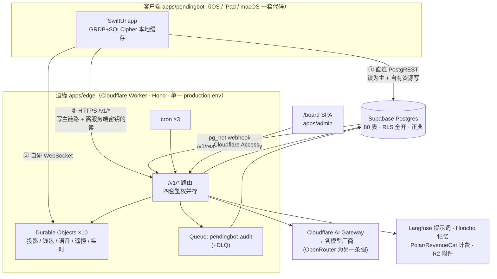
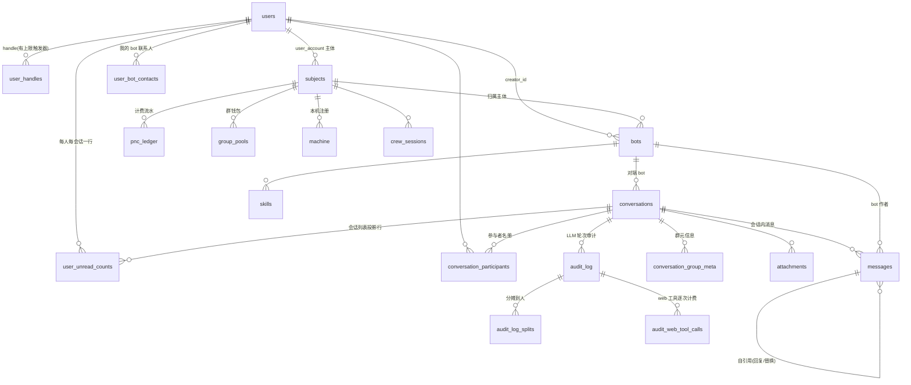
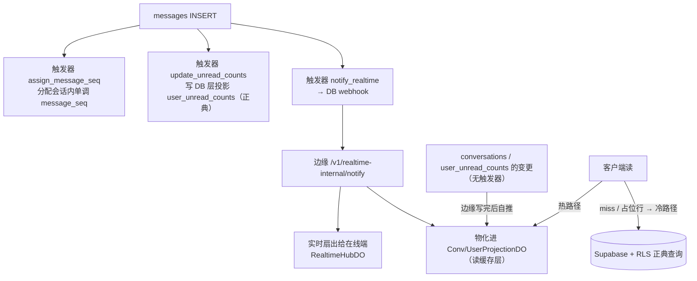
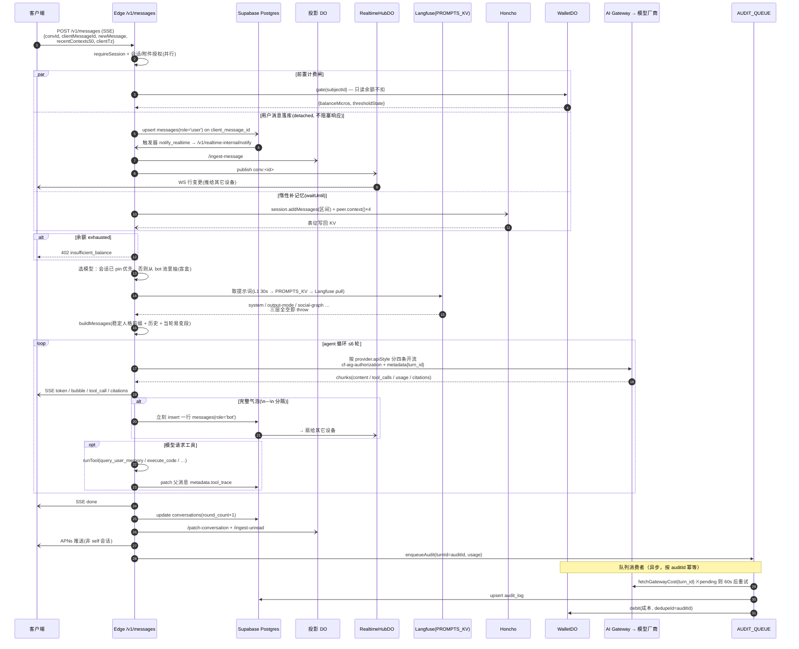
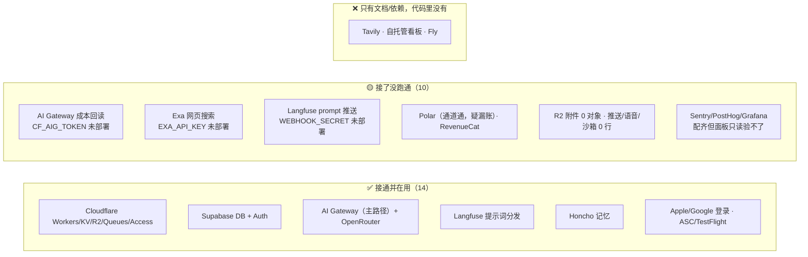

# PendingBot 架构总览

> **写于 2026-08-19。** 这份文档的每一条结论都来自**当前工作树的代码**或**线上只读查询**，
> 不引用 `docs/` 里的旧结论 —— 本仓库 7-18 到 8-15 的提交曾随本地 monorepo 误删而丢失，
> 树上找不到的"某某已完成"是常态。凡与其它文档冲突处，以本文为准，并请回头修那份文档。
> 证据格式：`路径:行`（代码）或标注"线上"（`supabase db query --linked` / `wrangler … list`）。
>
> **复核基线**：本地 `main` @ `5799f0a6`；生产 worker version `88b9f718`（2026-08-19T02:56Z，100% 流量）。

---

## 1. 一分钟版：这个系统长什么样

一个 **IM 形态的 AI 聊天产品**。用户在原生 app 里跟 bot（和其他人）聊天，
bot 的回复由大模型生成、按用量从钱包扣费。

四块：

| 块 | 是什么 | 位置 |
|---|---|---|
| **客户端** | 一个 SwiftUI 工程打 iPhone / iPad / Mac 三端 | `apps/pendingbot` |
| **边缘** | 唯一的胖后端：Cloudflare Worker（Hono），兼 10 个 Durable Object 的宿主 | `apps/edge` |
| **数据库** | Supabase Postgres，80 张表全开 RLS，是**数据的正典** | `supabase/` |
| **管理台** | Refine SPA，随 edge 一起部署到同源 `/board`，Cloudflare Access 守门 | `apps/admin` |



**理解整个系统的前提是这一条：客户端有两条通往数据的路。**
读大多直连 Supabase（靠 RLS 守门），写几乎全走边缘（需要服务端密钥、DO 状态、LLM、计费）。
只有"用户自有资源"（自己的 bot、技能、handle、联系人）是客户端直写 Postgres。
**这条双通道是很多困惑的根源，也是安全边界最容易破的地方**（见 §7）。

---

## 2. 最脆的三个地方（结论先行）

### 🥇 一、账本漂移：仓库已经不能完整重建线上

**线上应用了 212 条迁移，本地只有 208 个文件**（我独立复核过，双向 `comm` 对账）。
缺的 4 条全部落在 7-18～8-15 那个提交丢失窗口里：

| version | name |
|---|---|
| `20260807173452` | `crew_role_gate_permission_decide` |
| `20260808041925` | `short_links` |
| `20260811130504` | `machine_remote_control_heartbeat` |
| `20260812011217` | `machine_crew_index` |

反向没有漏 —— 没有任何本地文件未应用到线上。连带后果是
**`apps/edge/src/db/schema.ts` 已经和线上对不上**：缺 `short_links`、`machine_crew_index` 两张整表，
`machine` 表缺 6 列 —— 漂移点和那 4 条孤儿迁移**完全重合**。

为什么防线没拦住：lefthook 的 `schema-regen-check` 只在"有迁移文件进暂存区"时才触发，
**文件根本不存在时它无事可做**。这类漂移现有机制拦不住。

**好消息**：线上 `supabase_migrations.schema_migrations.statements` 是 `text[]`，
逐句存着迁移原文**连中文注释都在**，已实测可读出。重建这 4 个文件不用考古。

### 🥈 二、线上与仓库的真值反复对不上，而且方向不一

这不是一处笔误，是一类系统性问题 —— **配置有多个真值来源，读代码得不到真相**：

- **计费开关**：`wrangler.jsonc` 写 `BILLING_ENABLED="false"`，但线上 KV `cfg:feature-flags`
  实测是 `{"langfuse":true,"billing":true}`。语义是 `KV override ?? env 默认`
  （`apps/edge/src/lib/feature-flags.ts`），**所以生产的计费其实是开着的**。
  只读配置文件会得出完全相反的结论 —— 本次调研中就有一位 worker 正是这样判断的。
- **线上 worker 比仓库新**（tech-debt 已记 🔴）：任何一次 `deploy` 都是静默回滚。
- **secrets 两头都对不上**：代码要的 `EXA_API_KEY` / `CF_AIG_TOKEN` / `LANGFUSE_WEBHOOK_SECRET`
  线上没有（分别导致网页搜索工具不可用、主路径成本记不到、prompt webhook 恒 501）；
  反过来线上挂着 14 条代码零引用的历史 secret，其中**一条的名字本身就是一个 Daytona token 明文**
  —— `wrangler secret list` 谁都看得到，应当吊销并删除。旧的
  `SUPABASE_SERVICE_ROLE_KEY` / `SUPABASE_ANON_KEY` 这两个高权限凭证也还挂着。

### 🥉 三、RLS 出了 Postgres 就得靠人手复刻，而这层没有护栏

数据一旦被边缘读出来，Postgres 的 RLS 就不再保护它。边缘因此**把 RLS 手工重做了两遍**：

1. 资源级 —— `apps/edge/src/lib/route-authz.ts`（附件归属、发消息会话、群成员与角色、撤回与删除、bot 使用权）
2. 读投影级 —— `apps/edge/src/routes/projections.ts` + 投影 DO 里的 roster

代码里 fail-closed 的注释写得很密（`projections.ts:10-30` 那段是全仓最清楚的不变量说明），
当前实现也确实是安全的。**问题是这个"边缘授权门 ↔ Supabase RLS 必须对齐"是隐式不变量，
没有任何测试守护**（tech-debt 已记 🔴）。DB 侧改一条策略、边缘侧没跟上，不会有任何东西报警。

同一形态的问题在客户端也有一份：`SupabaseStack.authedClient()` 那道"写必须带登录态"的门
**当前 28 个写调用点全部合规**（已逐点回溯核过），但守它的只有一句注释
（`SupabaseStack.swift:59-61` 自己承认靠 code review）。下一个忘写的人，编译过、测试过，
只在真机无会话时炸成一个看起来像后端故障的 `permission denied`。

---

## 3. 客户端 `apps/pendingbot`

**一个 XcodeGen 生成的单 target、单 bundle id 的 multiplatform SwiftUI app**
（`com.pendingname.pendingbot`，iOS 17 / macOS 14）。168 个 Swift 文件、约 4.6 万行。
不走 Catalyst，Mac 是真原生 SwiftUI。

### 3.1 三端怎么共享一套代码

- **一个 target 打三端**，不是 target 分离（`project.yml:82`）。
- 唯一的目录级排除是 iOS 端排掉 `Sources/Mac/`（`project.yml:104`）；
  **macOS 侧不再用大锅排除**，改成逐文件 `#if os(iOS)`（`project.yml:105-110`）。
- 壳的分叉：iOS 窄屏 → `TabRoot`；**iPad 与 macOS 共用同一个三列壳 `WideRootView`**。
  每个业务面用 `FeatureSurface` 协议向壳暴露 `listColumn / detailColumn / compactRoot`
  三种装配（`Features/Root/FeatureSurface.swift:10-19`）—— 这是"一份代码喂两种壳"的关键抽象。
- **语音通话（WebRTC + CallKit）和推送是 iOS 独占**：`Features/Call/` 全部 13 个文件
  加 `PushService` / `VoiceCallAPI` 都是整文件 `#if os(iOS)`。

> ⚠️ `apps/pendingbot/README.md` 说 Mac 是"占位 View"、iPad 只接了机组一个 tab —— **整段过时**，
> 还引用了树上根本不存在的类型名 `PendingBotRegularRootView`。实际四个 tab 全接了共享壳。

### 3.2 数据层：直读 vs 走边缘的分界

分界规则不是随意的，从代码可以归纳出四条：

1. **读默认直连 Supabase**（`APIClient.swift:6-7` 的注释就这么写：这个 client 没有 GET 侧对应物）。
2. **两条热读路已经"边缘优先"**：会话列表 `GET /v1/conversations` 和消息尾 `GET /v1/messages/tail`
   先打投影 DO，miss / 可疑就回落正典 Supabase 查询。
3. **需要 service-role 越过 RLS 的读，一律走边缘**。典型是 `GET /v1/contacts`：
   `pendingbot.users` 的 RLS 是 self-only，客户端 join 对端资料只会拿到 null，
   所以由 worker 用 service-role 贴上。
4. **写：跨用户 / 有业务副作用 / 要计费的 → 边缘；用户自有资源行 → 直写 Postgres 靠 RLS。**

直写 Postgres 的只有这些：`bots`、`skills`、`skill_subscriptions`、`user_handles`、
`user_bot_contacts`、`bot_invites`、自己的 `users` 行、群聊 `messages` 直插、删会话。
其余（发消息主链路、群管理、好友请求、钱包、语音、推送、附件）全部 `POST /v1/*`。

**几个容易搞错的事实**：

- **API 域名是 `api.pendingname.com`**，不是 `bot.pendingname.com`。后者只用于
  Turnstile 挑战页 origin 和 Universal Link 关联域（`HostedConfig.swift:30` vs `:90`）。
- **Realtime 不是 Supabase Realtime**，是自研 `URLSessionWebSocketTask` 打边缘的
  `RealtimeHubDO`（`RealtimeSocket.swift:85`），upgrade 请求头带 Supabase JWT，
  指数退避重连 + 周期 ping。**无补发/回放**，断线靠重新 HTTP 拉。
- **本地缓存是 GRDB + SQLCipher 加密 SQLite**，不是 SwiftData / CoreData。
  校验 `PRAGMA cipher_version`，退化成明文 SQLite 就 `fatalError` 拒开（`LocalDatabase.swift:75-76`）。
- **Supabase Storage 完全没用**，附件走边缘 `POST /v1/upload` → R2。
- **没有离线写队列**。发失败就是失败，缓存只服务"秒开首屏"。

### 3.3 登录态与 Keychain

三个 provider 全部经 supabase-swift：Apple（`signInWithIdToken`）、Google（GoogleSignIn SDK）、
Email OTP（前置 Cloudflare Turnstile，iOS/macOS 各一套渲染层共用一个 ViewModel）。

**Keychain 三个独立槽位，无 App Group**：

| 用途 | service / group | 可访问性 |
|---|---|---|
| Supabase 会话 | `supabase.gotrue.swift`，默认组 | `AfterFirstUnlock` |
| SQLCipher 口令 | `com.pendingname.pendingbot` | `AfterFirstUnlockThisDeviceOnly`（不同步 iCloud）|
| 家族 SSO 凭据 `pfa_*` | **共享组** `M42BKJN82S.com.pendingname.shared` | 给 PendingCrew 静默登录用 |

`DataProtectionKeychainStorage` 存在的唯一理由：原生 macOS 的 `SecItem` 默认落 legacy 登录钥匙串、
ACL 绑签名二进制 → 每次重编都弹密码框。显式设 `kSecUseDataProtectionKeychain: true` 把三端拉到同一条静默路径。

**刷新策略值得单说**：冷启动**不阻塞网络** —— 有持久化会话就先用本地的（可能已过期的）立刻渲染，
刷新丢后台。后台刷新三分支：成功则更新；**`AuthError`（服务端判 refresh token 失效）才本地登出**；
**纯网络错误保留缓存会话不踢人**（`AccountStore.swift:87-110`）。这个区分是对的，别当 bug 改掉。

### 3.4 构建与发版

- **`project.yml` 是唯一事实源**，`project.pbxproj` 由 xcodegen 生成且已提交。
- **build 号 = 纪元日时间戳**：`<自 1970 起天数>.<当天秒数,%05d>`，如 `20683.07431`
  （`scripts/release/ios-build-number.sh:109`，注意脚本在**仓库根**不在 app 目录）。
  **刻意不从 git 历史算** —— 8-11 那版用 `git rev-list --count HEAD`，仓库丢失后从落后一个月的
  origin 拉回，提交数掉了 393，build 号倒退，ASC 直接拒收。
- 防倒退闸 `scripts/release/asc_highest_build.py` 查 ASC 跨版本全局最大 build 号，
  **拿不到数据一律非 0 退出**，绝不打印可被误读成"没有历史版本"的空值。
- ⚠️ **仓库里没有 committed 的 `.xcscheme`**，`project.yml` 也没有 `schemes:` 段。
  所有 `-scheme PendingBot` 的命令隐含"先跑过 `xcodegen`"这个前置条件，文档没写。

---

## 4. 边缘 `apps/edge`

**单 worker、单 env（`production`）、Hono 挂 `/v1/*` 的胖网关。**
它同时是：REST/SSE/WS API、10 个 Durable Object 类的宿主、1 条队列的 producer + consumer、
3 个 cron 的执行者、以及 board 管理台 SPA 的静态资源服务器。

`src/index.ts` 的装配顺序：`logger()` → CORS（`ALLOWED_ORIGIN` 未设时**拒绝所有浏览器源**，
故意 fail-closed）→ `/board/*` 转发 `ASSETS` → `/v1` 挂 30+ 个子路由器 → 裸 `/health` →
`/.well-known` AASA → `{fetch, scheduled, queue}` 三入口，整个被 `Sentry.withSentry` 包住。

> ⚠️ **多个文件挂同一前缀**（`/groups` ×3、`/sessions` ×4、`/crews` ×3、`/conversations` ×2、
> `/messages` ×2），Hono 按注册顺序匹配 —— 动这些文件时注意顺序。

### 4.1 四套鉴权并存

| 机制 | 入口 | 用在哪 |
|---|---|---|
| **Supabase JWT** | `requireSession()`（`packages/identity/src/middleware.ts:20`） | 绝大多数 `/v1/*` |
| **设备授权 `pdg_` token** | `requireSubjectAuth(scopes)`（`src/lib/device-grants.ts:72`） | crew / machines / upload |
| **Cloudflare Access** | `requireCfAccess()` + `requireBoardAdmin()`（`src/lib/cf-access.ts`） | `/board/*` 与 `/v1/board/*` |
| **Webhook 共享密钥 / 签名** | 各 route 自查 | DB webhook、Polar、RevenueCat、Langfuse |

JWT **是真验签**：`jose` 的 `createRemoteJWKSet` 拉 Supabase JWKS，算法白名单
`['ES256','RS256','EdDSA']`（`jwt.ts:15`，**故意堵死 HS256**），校验 issuer + `audience:'authenticated'`。
`c.var.userId` 就来自这里。

**一个容易读错的设计**：`requireSubjectAuth(['crew:write'])` 里的 scope **只约束设备授权那条腿**。
bearer 不以 `pdg_` 开头时它直接委托给 `requireSession()`，`requiredScopes` **完全不检查**
（`device-grants.ts:82-85`）。所以看到 `GET /v1/uploads/:id` 挂着 `crew:write` 不必惊慌 ——
但对普通登录用户来说那等价于"只要登录了就行"。

Cloudflare Access 那道门是**两层 fail-closed**：环境变量没配就 403（**没有 bypass 开关**），
且验出的 email 必须在 `BOARD_ADMIN_EMAILS` 白名单里。board 的授权与审计**不用 userId，用 email**。

### 4.2 错误信封 —— 契约有两个真实破口

线型（`src/lib/http-error.ts`）：`{ error: { code: ApiErrorCode, message?, detail? } }`，
`ApiErrorCode` 目前 **66 条**稳定 snake_case 码，iOS 按 `code` 分支。

**破口 1 —— 401 不走信封**：`requireSession()` 返回 `{error:'unauthorized', reason}`
（`middleware.ts:27,36`）。这是最常见的错误，却是唯一形状不一致的。
（客户端侥幸没受影响：`APIClient.validate` 把 401 单独映射成 `.unauthorized`。）

**破口 2 —— 429 不走信封**：`src/lib/rate-limit.ts:34-40` 返回
`{error:'rate_limited', message:…}`，`error` 是字符串不是对象。
而 `rate_limited` **明明就在 `ApiErrorCode` union 里** —— 这是漏改不是有意。
后果落到客户端：429 拿不到 `code`，所有按 code 分支的地方全部落空，只能显示截断的原始 body。

CLAUDE.md 明确写了"别用 bespoke `c.json({error:'foo'},400)` 形状"，这两处都违反了自己的约定。

### 4.3 限流：比想象中少得多

**只有 1 个 ratelimit namespace**（`wrangler.jsonc:237-243`）：`HANDLE_LOOKUP_RL`，30 次 / 60 秒。

全仓**只有 5 个调用点**，且**全部共用这同一个计数器**：handle 查找、发好友申请、
群邀请码 resolve、bot 邀请码 resolve、群 join。也就是说一个登录用户在这 5 条路径上
**共享** 30 次/60s 的总额度，不是每条各 30 次。

**上传、发消息、LLM 触发路径没有任何限流** —— 那些靠计费闸和 R2 配额挡。

### 4.4 Durable Objects（10 个）

全部是 `new_sqlite_classes`（SQLite-backed 存储后端），但"用不用 SQL API"各不相同。

| DO | 管什么 | 存储 | alarm |
|---|---|---|---|
| `ConvProjectionDO` | **T2 边缘读投影·每会话**：最近 1000 条消息尾 + roster（授权门用）+ 单调 `cur_rev` + `epoch`（DO 重建即换新→客户端全量重取）。2MB 行护栏：富列超 ~1.5MB 换成截断标记 | 纯 SQL | ❌ |
| `UserProjectionDO` | **T2 边缘读投影·每用户**：会话列表行 + 未读 + `cur_rev` + `epoch` | 纯 SQL | ❌ |
| `WalletDO` | 每 subject 一实例。**Polar 才是余额事实源**，本 DO 是边缘强一致缓存 + 门禁闸 + 用量 outbox。不是账本 | SQL + KV 混合 | ✅ 周期 flush + 稀疏对账 |
| `RealtimeHubDO` | 每 topic 一实例（`conv:<id>` / `user:<id>`），持可休眠 WebSocket，把 DB webhook 推来的行变更广播给在线端。**替代 Supabase Realtime** | 无 | ❌ |
| `GroupRouterDO` | 每群一实例：60s 滑窗计消息频率，决定"该谁说话"。路由本体在 alarm 里跑 → 天然串行，同群不并发 | KV | ✅ |
| `RoomVoiceDO` | 群语音**控制面**：参与者、bot 生命周期、权限、计费、roster。音频本身不在这里 | KV | ✅ 通话截止 |
| `RoomMediaContainerDO` | 极薄壳，包住 `apps/voice-container`（Bun 媒体引擎容器），只管生命周期 + WS 透传 | 无 | ❌ |
| `RealtimeMeterDO` | 每个 1:1 语音 session 一实例。开旁路控制 WS 到上游，**服务端计量 token，不信客户端自报** | KV | ✅ 硬超时 |
| `SessionProxyDO` | 每活跃 crew session 一实例：**跨端遥控枢纽**。N 个 viewer socket + ≤1 个 runner socket，runner 离线时命令排队 | KV | ❌ |
| `Sandbox` | 第三方（`@cloudflare/sandbox`），给 bot 的 `execute_code` 工具用的容器沙箱 | SDK 管 | SDK 管 |

**语音容器不能用 `lite` 规格**（1/16 vCPU 会重新引入把实时音频搬出 workerd 所要解决的卡顿），
`basic` 是允许的最小安全档 —— 这是写在 `wrangler.jsonc:215-222` 的硬约束。

### 4.5 队列与 cron

**只有一条队列、一种消息**：`pendingbot-audit`（+ `pendingbot-audit-dlq`，线上核实 1 producer / 1 consumer）。
唯一 producer 是 `enqueueAudit`（`src/llm/router.ts:305-315`），消费后写 `audit_log`。

几个设计细节值得记住：
- 消息里**绝不带 `aigToken`**（密钥不上队列），也去掉 OpenAI SDK 实例（不可 structured-clone）。
- `latencyMs` 在 **enqueue 时**算好 —— consumer 几分钟后才跑，那时 `Date.now()` 会严重高估。
- 抛 `GatewayCostPendingError`（AI Gateway 日志还没 ingest）→ `retry({delaySeconds:60})` 且**不报 Sentry**（预期竞态）；
  `max_retries` 从 3 提到 5 就是给这个 lag 留余量。
- **DLQ 刻意不消费**，由人工检查 —— 卡在那里的每条消息 = 一笔丢掉的扣费。

**cron 3 条**（账号上限 5，为此砍掉了每周模型定价同步和每小时 idle sandbox 清扫）：
每日 04:00 清 R2 孤儿附件 + 结束 28 天冷静期的账号注销；每 5 分钟捞回卡死的 envelope run；
每 30 分钟预热模型预设 KV。每个任务各自吞错互不毒害，失败上报 Sentry（无人值守，没有调用方会注意到）。

### 4.6 其它绑定

R2 `pendingbot-uploads-prod`（附件）、KV `MEMORY`（Honcho 记忆 / 模型目录 / feature flags / billing packs）、
KV `PROMPTS_KV`（Langfuse prompt 分发缓存）、Workers Assets（board SPA）。
**没有 D1** —— 所有关系型数据都在 Supabase。
线上多出一个代码里零引用的 KV namespace `ITEMS`，疑似遗留。

自定义域两个：`api.pendingname.com`（主 API）、`bot.pendingname.com`（只为 AASA —— 
副作用是 worker 拿走了整个 hostname，非 AASA 路径全落全局 404，注释里已承认）。

---

## 5. 数据库 Supabase / Postgres

**80 张表、10 个视图、148 个函数，全在 `pendingbot` schema。**

### 5.1 核心表与关系



**`subjects` 是理解计费的钥匙**：它是"计费与归属的统一主体"（`user_account` / `group_account`），
bots、machine、ledger、群钱包全挂在它下面。个人钱包的主体键曾经两侧不一致
（入账记 `subjects.id`、门禁读 auth user id），已由 `src/billing/subject-key.ts` 收敛成唯一解析器。

80 张表按域分：身份/账号、Bot、会话/消息、群/临时群、Crew（多 agent 编排）、计费、基础设施。

### 5.2 RLS：覆盖是完整的

- **80 / 80 张表全部启用 RLS**，查"未开 RLS 的表"返回空集。
- 103 条策略。**19 张表 RLS 开但零策略 = 默认拒绝**，纯 service-role（`short_links`、`tools`、
  `mcp_servers`、`preset_*`、`invites`、`admin_audit` 等）。
- 四类策略：own-row（`auth.uid()` 比对）、成员可见（走 SECURITY DEFINER helper）、
  公开只读/条件公开、完全 service-role。

**"成员可见"这一整类的地基是三个 SECURITY DEFINER 函数**：`is_participant`、`is_bot_invitee`、
`can_view_temporary_group`。RLS 的实际强度取决于这三个函数怎么写，而不是策略本身的写法。

客户端直读的 17 张表逐张核过 **RLS 兜得住，没发现敞口**。几处值得知道的：
- `users` 只有 `id = auth.uid()` 一条，**没有"好友可见"策略** —— 他人资料只能走边缘。
- `user_handles` 只有 own-row 读，**handle 查别人必须走边缘** —— 枚举面被 RLS 关死，
  边缘那层负责限速，两者配合才完整。
- `bots` 里 `creator_id IS NULL` 让**系统 bot 对所有登录用户可读**，这是预置 bot 需要的，
  属设计意图，但它是这张表上唯一一处"宽"的地方。

> 口径：以上基于策略定义与 helper 函数存在性核对，**未以真实 JWT 做 `SET ROLE` 实测**。
> 要把结论从"策略写对了"升级成"实测兜住了"，需另跑一轮复现。

### 5.3 迁移账本

208 个本地文件：legacy 4 位数段 50 个（编号不连续，缺号是跳号不是丢文件 —— 线上账本里同样没有那些版本），
时间戳段 158 个。**与线上的对账结果见 §2.1** —— 这是本次调研最重要的发现。

---

## 6. 会话列表投影：一段被讲错的历史（单独讲，因为最容易误解）

这一段值得单列，因为**流传的说法是错的**，而错误的版本会推出错误的架构结论。

**流传的说法**：曾经有触发器做会话列表维护，后来撤掉了，改成边缘 DO 投影写穿。
→ 会推出"会话列表现在完全归边缘管"。

**线上事实**：那个维护触发器**从未被撤掉，至今在跑**。撤掉的是同一张表上的**另一个**触发器。

这里其实有**两层投影**，不是一个：

**(A) DB 层投影 `user_unread_counts` —— 仍是正典，仍由触发器维护**

`messages_unread_after_insert` → `update_unread_counts()`，建于 `0001_init.sql:1382`，
线上 `pg_trigger` + `pg_get_functiondef` 双重确认现役。一次 insert 里既推进发送者的已读水位，
又对全体参与者 upsert `unread_count` + `last_message_id/seq/at/preview`。
**会话列表所需的那套数据，今天仍然由 DB 触发器写。**

**(B) 被撤掉的那个 —— `user_unread_counts` 上的 `realtime_notify`**

`20260529043410_message_sequence_read_receipts.sql:165`：

```sql
-- Stop per-recipient DB -> Edge webhook fanout. Edge now publishes
-- user-level state after message writes/read acks.
DROP TRIGGER IF EXISTS realtime_notify ON pendingbot.user_unread_counts;
```

撤的是**扇出**（一条群消息 30 个参与者就是 30 条 DB→Edge webhook，N 倍放大），
**不是维护**。该迁移的文件头说得很清楚：*"keeps the DB as source-of-record,
but moves user-hub fanout to the Worker"*。

**(C) 边缘 DO 投影 —— 第二层读缓存，而承诺的那半曾经烂尾**

`ConvProjectionDO` / `UserProjectionDO` 是给客户端 edge-first 读的缓存层，两条喂养通道：
① 有 `realtime_notify` 的表（`messages`、`conversation_participants`）由 webhook 顺手物化；
② 没有触发器的表（`conversations` **从来就没有过**；`user_unread_counts` 的扇出在 5-29 被撤）
由边缘自推。

**烂尾点**：(B) 撤扇出时承诺的"边缘自己发"这半，**直到最近的修复前从未接上**。
后果是投影里长期存在**永远补不全的占位行** —— 新会话只拿到 participants 那一下写进去的空壳
（标题空、bot 空、预览空、时间戳停在加入那一刻），而"随后补全"的通知永远不来。
这就是 Mac 端一直画着 17 小时前旧数据的病根。

**修法不是把触发器补回去，而是兑现承诺的另一半**（`fix/edge-projection-writethrough` 那批提交），
并立下一条硬规矩：**投影里不再允许占位行 —— 拿不到会话行就什么都不写并 loudly 报错，
因为一个永远等不到补全的占位行比没有这一行更糟。**
客户端还留了一道纵深防御：按行识别服务端写的 `unknown` 标记，占位行回落正典查询，健康行照吃投影。

**现在的分层（记住这张图就够了）**：



**一句话**：DB 触发器是正典写入方，边缘 DO 是读缓存；被撤的只是"DB 直接扇出给每个收件人"这条推送通道。

> 注：`apps/edge/src/lib/projection-writethrough.ts` 的**文件头注释**按字面读容易理解成
> "维护投影的触发器被删了"（同文件后面的 `ProjectionTable` 注释其实说对了）。
> 这是注释精度问题，不是代码 bug —— 代码行为是对的。客户端
> `ConversationFetch.swift:123-124` 的注释沿用了同样的措辞，也应以本节为准。

---

## 7. 对话链路：一条消息的一生

先破除一个误解：**这不是"发消息 + 异步等回复"，而是一个 SSE 长连接**。
`POST /v1/messages` 在同一个响应里流式吐出 bot 的回复（首轮新会话走 `POST /v1/messages/start`）。



### 7.1 触发 bot 回复的三条路（互斥）

| 会话类型 | 机制 |
|---|---|
| 1v1 / self（有 bot） | **同步**，SSE 流里直接跑 `runChatTurn`（`lib/bot-reply/index.ts:286`）|
| 群 | **DO alarm**：60s 活跃窗 + 8s debounce，`@提及` 绕过 debounce 立刻派发。alarm 里**串行**逐 bot 跑，气泡靠 realtime hub 送 |
| 人对人 / 无 bot | 不触发，只 ack |

**SSE 的一个关键设计**：传给 `runChatTurn` 的是 **detached AbortController**，不是请求的 signal。
客户端断线只停 emit，**LLM 回合继续跑完并落库**，再由 realtime hub 补送。这是有意的，别当泄漏改掉。

工具循环上限 6 轮。`send_images` 是唯一的终止型工具 —— 调用它本身就是消息，跑完即 break。

### 7.2 提示词：Langfuse 是唯一事实源

三层：进程内 L1（30s TTL）→ `PROMPTS_KV`（无 TTL，靠 webhook 推）→ Langfuse pull（回写 KV）。
**三层全空就 throw**，仓库里没有任何 bundled 副本 —— 核实属实（`llm/prompt-loader.ts:163-172`），
注释写明理由："一个似是而非的过期提示词比一次响亮的失败更糟"。

代价是 **prompt 取不到 = 整条对话链路 500**。Langfuse 宕机撞上 KV 冷 isolate 会直接打死聊天，
KV 无 TTL 是唯一缓冲。而 `LANGFUSE_WEBHOOK_SECRET` 线上没设，webhook 恒 501 ——
**改了提示词只能靠 miss 时拉，可能长期不生效**。

### 7.3 模型路由：**没有降级链**（最容易写错的一段）

流传的"AI Gateway 主路径 + OpenRouter fallback"**在代码里不存在**。真实情况：

1. **选模型的不是 router**：`chooseConversationMainModel` —— 会话已 pin 的模型优先，
   否则从 bot 的模型池里抽（盲盒），然后写回会话。
2. **选 provider 的是 `bots.model_provider`**：`resolveProviderSlug` 只认
   `openrouter / openai / anthropic / google-ai-studio` 四个值，**其它一切（含 null）落回 `openrouter`**。
   OpenRouter 是**默认值**，不是降级目标。
3. **`resolveRoute` 是 passthrough**：模型 slug 原样透传，只拼 AI Gateway 的 base URL。
4. **`withFallback` 名不副实**：失败后把该 provider 加进排除表，而 passthrough 下一路只有一个
   provider，下次解析立刻 `NoRouteError` 就 break。**真实重试次数 = 1**。
   文件头注释自己承认了这点。保留它只为统一 route_trace 和错误分类。

所有请求走一个 AI Gateway，**不带任何上游 provider key**（显式把 SDK 的 `Authorization` 置 null），
由账户的 AI Gateway credits 付上游。唯一例外是 `google-ai-studio` 走 BYOK alias
（Gemini 3.x 不在 Unified Billing 原生透传里）。

> ⚠️ 代码注释里记着一个坑：在网关 dashboard 给某个 UB provider 留一个陈旧 BYOK key，
> 会劫持那条腿走 BYOK 并报 "Configured BYOK credentials are unavailable"，**且不会回落 credits**。

### 7.4 记忆（Honcho）

两个接触点，**热路径从不阻塞 Honcho**：

- **写（惰性补记忆）**：`waitUntil`，仅当客户端传了 `oldestContextMessageId` 才触发。
  把客户端窗口之前的历史补进 Honcho，**排除已撤回和 log 行**（撤回的消息模型必须忘掉），
  再把 4 份表征（双方各自的自我认知 + 各自眼中的对方）写回边缘 KV。
- **读（`query_user_memory` 工具）**：查的是 **bot peer 对 user 的局部表征**，不是 user 的全局表征
  —— 把答案锁在 (bot, user) 这一对里。**群里额外加 session scope**，防止把 1v1 私聊内容泄进群。

失败全部吞掉留旧值，prompt 里的记忆段一律读 KV，冷则为空并回落 `identity-quest` 提示词。

### 7.5 计费：闸在生成前，扣费在生成后

- **前置闸** `gateConversation` 与 bot 查询并行发起、开 SSE 前 await。群路径的闸在 DO 派发处
  （`lib/group-dispatch.ts:89` —— 顺带说明：`routes/messages.ts:203-205` 那条"群门禁未接"的注释
  和对应的 tech-debt 条目**已经过期**，门禁已经接上了）。
- **扣费**在 AUDIT_QUEUE 消费者里，按 `auditId` 幂等，失败 log+吞（计费打嗝绝不能破坏已落地的回合）。
- **谁付钱**由 `resolveBillingSubjectId` 唯一解析：群→会话的责任主体；临时群/crew→群元信息的责任主体；
  其余→该用户的 `user_account` subject。**路由键一律是 `subjects.id`，绝不能是 auth user id**
  —— 代码注释直接点名这是 2026-08-18 计费事故的根因（个人钱包被路由到一个永远空的 DO）。
- 阈值四档 `sufficient / low / throttle / exhausted`，**只有 `exhausted`（≤0）硬停**，透支下限 −0.5 PNC。
- **门禁到处 fail-open**：解析失败、WalletDO 读失败一律放行。这是 8-18 事故后的**刻意选择**
  （宁可漏计费也不误锁用户），代价是 WalletDO 挂掉时消费无上限。

> **余额不足返回 402 `{error:'insufficient_balance', balance_credits, min_threshold}`
> —— 又一处不走统一信封的地方。** 这直接导致客户端只能做子串匹配（见 §8）。

用量落 `pendingbot.audit_log`（一行 = 一个逻辑回合，`auditId = turnId`，兼作幂等键）
+ 子表 `audit_web_tool_calls`。真账本是 `pnc_ledger`。

---

## 8. 客户端 ↔ 边缘的契约：最脆的一环

统一错误信封 `{error:{code, message?, detail?}}` 是**约定**，但有三处破口，
且它们恰好覆盖了最常见的失败：

| 破口 | 形状 | 后果 |
|---|---|---|
| **401 未登录** | `{error:'unauthorized', reason}` | 客户端侥幸没事（单独映射成 `.unauthorized`）|
| **429 限流** | `{error:'rate_limited', message}` | **客户端拿不到 `code`**，所有按 code 的分支落空，只能显示截断的原始 body |
| **402 余额不足** | `{error:'insufficient_balance', balance_credits, …}` | 见下 |

客户端这边镜像了信封（`APIClient.swift:180-190`，只解 `code` + `message`，`detail` 刻意不进 Decodable），
并在语音、权限卡、群账号、群钱包四个面按 `code` 分支。

**但发消息主链路是例外**：`ChatStream` 有自己的错误类型，**完全不解析 typed envelope**。
于是判断"余额不足"变成了：

```swift
if rawText.contains("insufficient_balance") { showInsufficientBalance = true }
```

（`ConversationView.swift:1994`，函数注释自己承认"只做子串检测"。私聊和群聊**两条发送路径都这样**。）

**边缘那边改一次 code 拼写或文案，这里就静默失效** —— 用户会看到一个原始报错而不是充值引导。
这是整个客户端↔边缘契约上最脆的一处，而它的根因（402 不走信封 + `ChatStream` 不解信封）在两侧各占一半。

---

## 9. 外部服务依赖

本 crew 的 21-5 已经做过一份 26 家服务的逐家取证盘点（证据来源：代码 + `wrangler secret/kv/r2/queues/containers/deployments list` + 线上 Supabase 只读 SQL + 公开端点实测），
明细在 `docs/progress.md` 顶部与 `docs/state/shared.md`。这里只把它接进架构：



**架构上要记住的三条**：

1. **提示词、记忆、模型三样都是外部托管的，且都在对话热路径上。** Langfuse 取不到就 throw，
   Honcho 挂了会降级（有 KV 缓冲），模型走 AI Gateway。三者里只有 Langfuse 是硬依赖。
2. **钱不在自己手里**：Polar 是余额的事实源（MoR），WalletDO 只是边缘缓存 + 门禁闸，
   iOS 内购身份走 RevenueCat。自研的只有"群分摊"那部分。
3. **🟡 那一档基本都是"代码接好了，secret 没推"** —— 不是设计缺陷，是部署账没对齐（见 §2.2）。

---

## 10. 边界在哪

| 边界 | 谁负责 | 越界的代价 |
|---|---|---|
| **客户端 ↔ Postgres 直连** | RLS 是唯一防线 | RLS 写错 = 直接数据泄漏。目前 80/80 开、17 张直读表核过没敞口 |
| **客户端 ↔ 边缘** | 类型化错误信封 + JWT | 信封破口已致客户端做子串匹配（§8）|
| **边缘 ↔ Postgres** | 边缘手工复刻 RLS（`route-authz.ts` + 投影授权门）| 无测试守护，DB 改策略边缘不会知道（§2.3）|
| **DB 正典 ↔ 边缘投影** | DB 触发器写正典，边缘 DO 是读缓存 | 混淆两者会得出"会话列表归边缘"的错误结论（§6）|
| **仓库 ↔ 线上** | 迁移账本 + wrangler 配置 | 已经漂了：4 条迁移、schema.ts、secrets、feature flags（§2.1、§2.2）|
| **PendingBot ↔ PendingCrew** | 家族 SSO 凭据是**字节级契约**（service / access group / JSON 字段名必须完全一致）| PendingCrew 已于 2026-08-17 拆成独立仓库，改这个契约要两边同步 |

---

## 11. 结构性风险清单（架构视角）

`docs/tech-debt.md` 已有完整条目，这里只按架构面归类、指出哪些是**同一个病根的不同症状**。

### 病根 A：不变量靠注释守，没有机制

| 症状 | 位置 |
|---|---|
| 边缘授权门 ↔ Supabase RLS 对齐（🔴，无测试守护）| `route-authz.ts` / `projections.ts` |
| 客户端写必须走 `authedClient()`（当前 28/28 合规，但只有注释在守）| `SupabaseStack.swift:59-61` |
| `cron/index.ts` 与 `wrangler.jsonc` 的 cron 表必须手工同步 | 两处 |
| 迁移文件与 schema.ts 的对齐（lefthook 拦不住文件丢失）| `lefthook.yml` |

### 病根 B：真值有多个来源

| 症状 | 位置 |
|---|---|
| 计费/观测开关：配置文件 vs 线上 KV（🔴，且方向相反）| `wrangler.jsonc` vs `cfg:feature-flags` |
| 线上 worker 比仓库新，deploy 即静默回滚（🔴）| `apps/edge` |
| secrets：代码要的没有，线上有的代码不读（含一条明文 Daytona token）| 生产 secret 列表 |
| 迁移账本：线上 212 / 本地 208（🔴）| `supabase/migrations/` |

### 病根 C：统一约定没有贯彻到底

| 症状 | 位置 |
|---|---|
| 错误信封三处破口：401 / 429 / 402 | `middleware.ts` / `rate-limit.ts` / `messages.ts:1383` |
| 客户端因此靠子串匹配识别余额不足 | `ConversationView.swift:1994` |

### 病根 D：规模上去会变形的设计（当前流量低看不出来）

| 症状 | 说明 |
|---|---|
| **`fetchGatewayCost` 只扫最近 100 条网关日志且无过滤** | 并发一上来自己那条会掉出首页 → 永远 PENDING → 队列反复重试直到进 DLQ（每条 DLQ 消息 = 一笔丢掉的扣费）|
| `patchConversationProjection` 每轮打全体受众 | 大群里是 O(成员数) 次 DO RPC / 轮 |
| 5 条限流路径共用一个 30 次/60s 计数器 | 一个用户在这 5 条路上共享总额度 |
| 同一个 user realtime topic 开了两条 WS | 功能无碍，资源重复 |

### 单独拎出来：一条正在发生的收入泄漏

**这条是三份笔记交叉 + 我自己线上复核才拼出来的，之前没有被单独记过：**

- 线上 KV 实测 `{"billing":true}` → **计费是开着的**（`billingEnabled` 的语义是 KV override 优先，
  已核到 `feature-flags.ts:63-77`）。
- 但 `CF_AIG_TOKEN` 生产**没设** → `fetchGatewayCost` 第一行就短路返 null
  → 非 OpenRouter 腿（anthropic / gemini / openai 三条原生腿）的**唯一成本源没了**。
- 成本 null → `billing_status='skipped'` → **不触发扣费**（扣费只在 `'billed'` 时发生）。
- 线上验证：最近 5 条 `anthropic` 的 `message_reply` **全部 `cost_usd = null` / `billing_status='skipped'`**；
  同一秒的标题级联走 OpenRouter 腿（自报成本）就有值。

**即：现在走原生 provider 腿的对话，是在计费开着的情况下一分钱扣不到。**
修法是给生产设 `CF_AIG_TOKEN`（AI Gateway Logs 读权限）—— 但**在设它之前，先把 §11-D 那条
"只扫 100 条日志"的规模坑一起看**，否则量一上来又会变成队列反复重试。

---

## 12. 本次发现的文档漂移（该修的）

| 文档 | 问题 |
|---|---|
| `docs/architecture-file-map.md` | 6-18 自动生成，**227 处仍在描述已拆走的 `apps/pendingcrew`**；且它把 `room-media-protocol.ts` 之类纯函数文件全标成 Durable Object。是文件索引，不是架构文档，**不能当架构结论用** |
| `apps/pendingbot/README.md` | 平台状态表整段过时：说 Mac 是"占位 View"、iPad 只接了一个 tab，还引用树上不存在的类型名 `PendingBotRegularRootView` |
| 仓库根 `README.md` | 结构图里仍列 `apps/pendingcrew/` |
| `docs/deploy.md` | 让人去删 `CODE_SIGNING_ALLOWED=NO`，但 `project.yml` 里早已没有这两行；且未提"先跑 xcodegen 才有 scheme"这个前置条件 |
| `apps/edge/src/lib/projection-writethrough.ts` 文件头 | 措辞让人以为"维护投影的触发器被删了"（实际删的是扇出触发器），客户端 `ConversationFetch.swift` 的注释沿用了同样措辞 |
| `apps/edge/src/routes/messages.ts:203-205` + 对应 tech-debt 条 | "群 bot 回复前置门禁未接"已过期，门禁已接在 `group-dispatch.ts:89` |
| `RealtimeManager.swift:80-82` | 注释说"iOS crew 面已移除"，但机组 tab 早已回来 —— 导致 conv topic 上的 crew 帧**至今被硬丢弃**。这条不只是漂移，**可能是功能缺口** |
| `Telemetry.swift:23-25` | 说 RevenueCat key 还是空的，实际已填 |
| `lib/bot-reply/index.ts:684-685` | 注释指向不存在的文件 `tools/start-crew.ts`。**好消息**：bot-reply 里那套 captain 编排残留**实体已经清干净了**，只剩这一句悬空注释 |

---

## 13. 这份文档是怎么得出来的

四个只读 worker 并行摸客户端 / 边缘 / 数据库 / 对话链路，各自产出带 `文件:行` 出处的笔记，
由机长汇总并**裁定冲突**。全程只读：没有改任何代码、没有写数据库（只跑 SELECT）、没有部署。

**三处 worker 之间或 worker 与文档之间的冲突，由机长用线上实据裁定：**

1. **会话列表触发器到底撤没撤** —— 边缘面按代码注释说"撤了"，数据库面查线上说"没撤"。
   裁定：查 `pg_trigger` 确认 `messages_unread_after_insert` 至今在跑，
   再读 `20260529043410:160-166` 确认 DROP 的目标是 `user_unread_counts` 上的 `realtime_notify`。
   **数据库面正确**（§6）。
2. **计费开关到底开没开** —— 三份笔记都读 `wrangler.jsonc` 说"关"。
   裁定：读 `feature-flags.ts` 确认语义是 KV override 优先，再实读线上 KV
   `cfg:feature-flags` = `{"langfuse":true,"billing":true}`。**三份笔记都错，计费是开着的**（§11）。
3. **迁移账本差额** —— 数据库面报"线上 212 / 本地 208"。
   裁定：机长独立跑双向 `comm` 对账复核，结论一致（§2.1）。

**复核方法**（想自己验证的话）：

```bash
# 迁移账本对账
supabase db query --linked "select version,name from supabase_migrations.schema_migrations order by version;"
ls supabase/migrations/*.sql | sed 's|.*/||; s/_.*//' | sort   # 与上面比

# 线上触发器
supabase db query --linked "select c.relname, t.tgname, p.proname from pg_trigger t
  join pg_class c on c.oid=t.tgrelid join pg_namespace n on n.oid=c.relnamespace
  join pg_proc p on p.oid=t.tgfoid where n.nspname='pendingbot' and not t.tgisinternal;"

# 线上真实开关（不是 wrangler.jsonc！）
cd apps/edge && npx wrangler kv key get "cfg:feature-flags" --binding MEMORY --env production --remote

# 线上部署版本 / secrets 名单
cd apps/edge && npx wrangler deployments list --env production
cd apps/edge && npx wrangler secret list --env production
```
